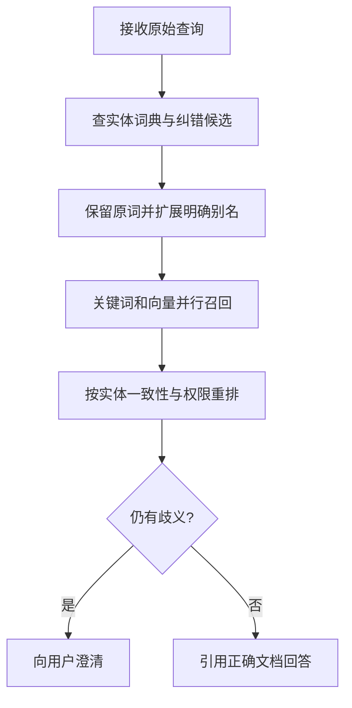

# 180｜企业知识库怎样处理简称与错字

> **场景引入**：用户搜“采通”，公司却有两个名称相近的系统。改写查询前要保留原词并核对实体和部门。

> 对应[原始材料](../origanl/180-RAG如何处理简称与错字？.md)。

---

## 🎯 一句话定位

用受控别名和纠错候选扩展查询，保留原词，歧义时澄清。

## 💎 核心要点概览

| 问题 | 处理 |
| --- | --- |
| 简称 | 实体词典扩展 |
| 错字 | 候选纠错并核对上下文 |
| 歧义 | 保留多候选或询问 |

## 🚀 核心总结

> 扩展查询提高召回，但不能扩大用户权限或暗中猜实体。

---

## 一、既保留原词，也扩展候选

正式系统叫“采买通”，用户输入“采通”。直接替换可能猜错；完全不处理则可能漏召。应将原词与受控别名候选一并检索，用业务实体、部门与权限校验结果。

词典应有维护人和更新时间；新别名可从零召回日志中发现，再经人工审核入库。纠错阈值不能只靠编辑距离，因为两个近似系统名可能属于不同部门。评估时把别名、错字、拼音和歧义简称分桶，分别看召回率与误召率。

权限过滤必须在最终返回前生效；查询扩展不能扩大用户可见文档范围。

**面试表达：**“我做可审核的别名扩展和混合检索，保留原查询、有歧义就澄清，并分场景评测。”

---

## 二、落地 Checklist

- [ ] 词典设置维护人、更新时间和适用部门。
- [ ] 记录原始查询、改写候选和最终选用实体。
- [ ] 分桶评估别名、错字、拼音与歧义的误召率。

## 三、总结（一句话带走）

> **先扩展候选，再靠实体与权限核对结果。**
