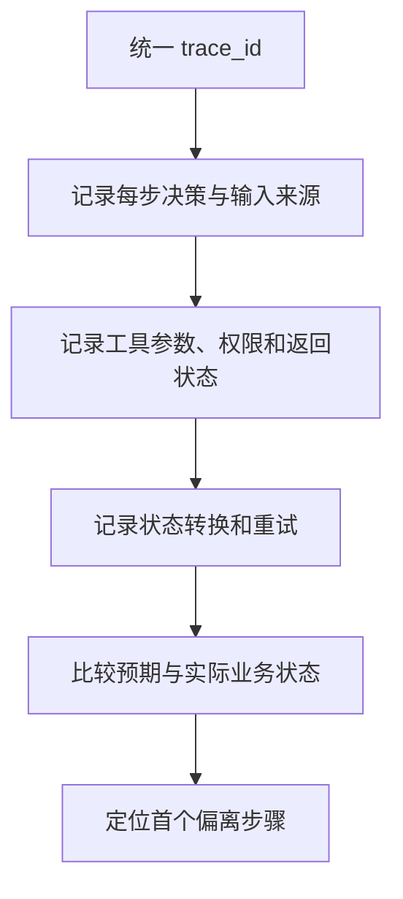

# 181｜Agent 连续调用工具，错在哪里

> **场景引入**：发券最后一步失败，原因可能是前一步客户类型传错。只看末尾报错无法确定首个偏差。

> 对应[原始材料](../origanl/181-Agent连续调用工具出错怎么查？.md)。

---

## 🎯 一句话定位

用步骤级 trace 还原决策、参数、工具事实和状态转换，定位最早错误。

## 💎 核心要点概览

| 记录 | 用途 |
| --- | --- |
| step 与父步骤 | 还原依赖 |
| 参数来源和返回 | 分清模型与工具错误 |
| 幂等键与业务 ID | 查真实副作用 |

## 🚀 核心总结

> 排障从首个状态偏移点开始，不从最后一条异常猜原因。

---

## 一、追踪“错误首次出现的位置”

最终发券失败，根因可能是上一环节传错客户类型，也可能是券模板已失效。只看最后一条错误日志，无法区分模型决策、参数构造、工具故障和状态解释。

每步至少记录 `step_id`、父步骤、工具名、参数来源、脱敏入参、结果摘要、耗时、重试次数、幂等键及实际业务对象 ID。不能只记录模型“想做什么”，还要查工具执行后的事实。对敏感信息做脱敏与权限控制，避免 trace 本身泄露数据。

可用相同版本的 Prompt、模型配置、工具响应快照复放故障；外部写操作在回放环境应禁用或替身化，防止重复副作用。

**面试表达：**“用步骤级 trace 找第一个状态偏移点，结合工具返回与实际业务状态定位原因，再把样例纳入回归。”

---

## 二、落地 Checklist

- [ ] 每步记录输入来源、参数、工具状态、重试和业务对象 ID。
- [ ] 对照真实业务状态找首个偏差。
- [ ] 固定版本并在无真实副作用环境安全回放。

## 三、总结（一句话带走）

> **工具链排障要找第一处偏离，而非只修末尾报错。**
