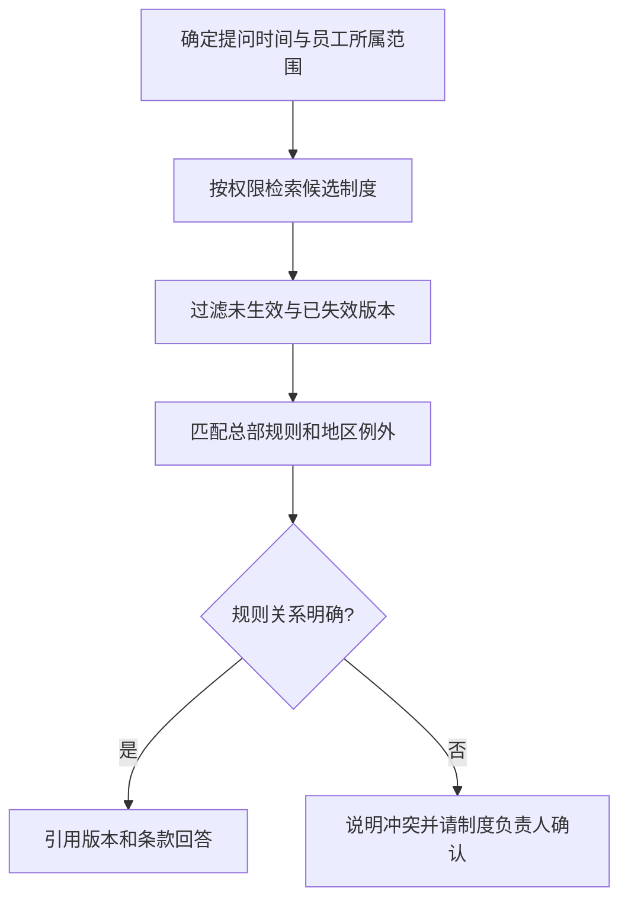

# 182｜新旧制度同时存在，RAG 用哪一版

> **场景引入**：总部发布新制度，华南子公司仍有特定员工适用的补充条款。发布日期最新并不意味着适用范围最大。

> 对应[原始材料](../origanl/182-RAG如何判断新旧制度生效？.md)。

---

## 🎯 一句话定位

制度选择要同时匹配时间、组织、地区、事项和补充关系。

## 💎 核心要点概览

| 维度 | 核对 |
| --- | --- |
| 时间 | 生效与失效日期 |
| 范围 | 组织、地区、人员 |
| 关系 | 补充、替代、废止 |

## 🚀 核心总结

> 最新发布不是自动适用，历史业务还可能使用历史版本。

---

## 一、生效规则比发布时间更重要

总部新差旅制度已发布，不代表覆盖所有地区；华南子公司的补充条款也可能只适用于特定员工。要核对生效日、失效日、适用组织、地区、事项和补充/废止关系。

入库元数据记录制度 ID、版本、发布日期、生效日期、适用组织、废止文号、补充关系和来源页码。用户问“去年出差报销标准”，就要按去年时点检索，不能总用当前版。若人事系统中的所属组织与用户自述冲突，涉及权限时应以授权系统为准并请用户确认。

**面试表达：**“我将时间和适用范围前置到检索与仲裁，保留原条款引用；最新发布不自动等于当前适用。”

---

## 二、落地 Checklist

- [ ] 入库保存版本、生效区间、组织和补充关系。
- [ ] 从问题提取业务时间与员工适用范围。
- [ ] 冲突时展示来源并请制度负责人确认。

## 三、总结（一句话带走）

> **制度效力由时间与适用范围决定，不由上传顺序决定。**
