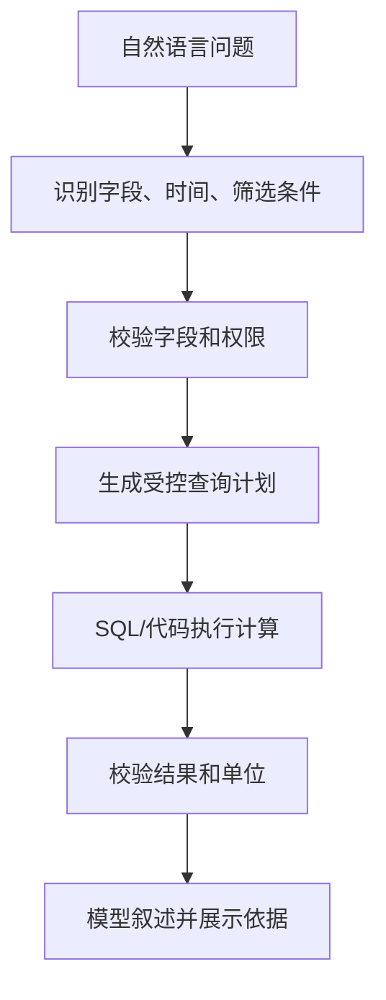

# 184｜表格问答：模型理解，程序计算

> **场景引入**：用户问华东区上季度成交额环比。模型可识别地区和指标，聚合与除法应由受控 SQL 或代码完成。

> 对应[原始材料](../origanl/184-表格问答让大模型读还是代码算？.md)。

---

## 🎯 一句话定位

模型做语义映射与解释，确定性程序做计算和数值校验。

## 💎 核心要点概览

| 环节 | 责任 |
| --- | --- |
| 理解问题 | 字段、时间、筛选条件 |
| 计算 | SQL、聚合、去重、环比 |
| 说明结果 | 口径、单位和来源 |

## 🚀 核心总结

> 财务数字需要可审计计算链，模型不能凭表格印象生成。

---

## 一、分工不是二选一

用户问“华东区上季度成交额环比”，模型可以解析“华东区”“上季度”“成交额”“环比”，但聚合、去重与除法应交给 SQL 或确定性代码。最后模型解释数字及口径。

若上季度 120 万、前季度 100 万，程序计算环比为 20%。但还需明确是否含税、是否含退款、季度按自然季度还是财年。模型生成的 SQL 应经过字段白名单、只读权限、行数与成本限制，不允许直接执行任意语句。

表格很小时模型可能算对，不能因此把可审计财务结果交给概率生成。输出中所有数字应能回溯到查询结果。

**面试表达：**“模型负责语义映射和解释，程序负责计算；查询和答案都做口径、权限及数值校验。”

---

## 二、落地 Checklist

- [ ] 明确税费、退款、去重和季度口径。
- [ ] 查询使用字段白名单、只读权限和成本限制。
- [ ] 输出数字逐项回溯查询结果。

## 三、总结（一句话带走）

> **让模型理解问题，让程序给出数字。**
