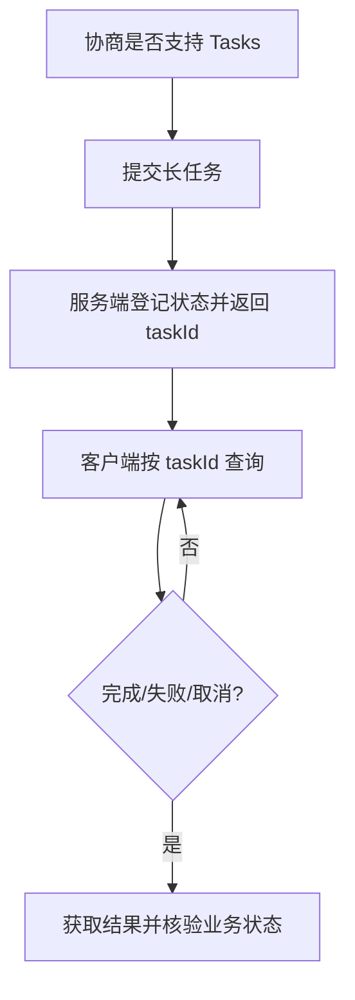

# 185｜MCP Tasks 与工具调用挂起的区别

> **场景引入**：批量处理运行十分钟，HTTP 连接中断后客户端还想查询进度。独立任务句柄比一直等当前调用更适合恢复。

> 对应[原始材料](../origanl/185-MCP任务与工具挂起的本质区别.md)。参考 [MCP Tasks 规范](https://tasks.extensions.modelcontextprotocol.io/specification/draft/tasks)。

---

## 🎯 一句话定位

Tasks 把长操作建成可查询的任务对象，普通调用主要依赖当前请求返回结果。

## 💎 核心要点概览

| 方式 | 适用 | 关键风险 |
| --- | --- | --- |
| 普通调用 | 短而稳定 | 断线后结果难找回 |
| Tasks | 长任务、批处理 | 状态持久化与幂等 |

## 🚀 核心总结

> 有 taskId 不代表自动可靠，服务端还需保存状态并验证业务结果。

---

## 一、区别在状态归属

一直等待的普通工具调用，客户端主要依赖当前调用得到结果；Tasks 扩展返回任务句柄，可在之后查询状态、结果或取消。普通调用断开并不必然意味着服务端工作停止或状态丢失，具体取决于实现；但若没有独立任务 ID，客户端难以可靠地找回它。

在生产中还需任务持久化、重试幂等、结果保留期限、权限校验、取消语义和断线恢复。提交成功只是“已受理”；`completed` 也要检查工具结果是否含业务错误。短而稳定的操作可以保持普通调用；批处理、审批等耗时任务更适合独立状态。

**面试表达：**“Tasks 把长操作变成可管理的任务对象，核心是句柄与状态机；可靠性仍取决于持久化和幂等实现。”

---

## 二、落地 Checklist

- [ ] 依据耗时和断线恢复需求选普通调用或 Tasks。
- [ ] Tasks 持久化状态、权限、保留期限和取消语义。
- [ ] 完成后核对业务结果，重试使用稳定幂等标识。

## 三、总结（一句话带走）

> **长任务要有能找回的状态，而不只是等待更久。**
