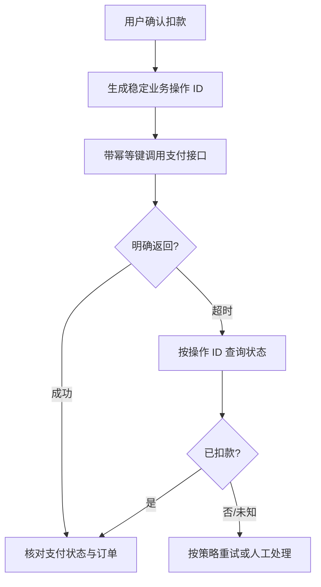

# 186｜Agent 重试如何避免重复扣款

> **场景引入**：支付接口超时，响应丢了，但钱可能已扣。立即用新请求重试，会有重复扣款风险。

> 对应[原始材料](../origanl/186-Agent如何避免重复扣款？.md)。可参阅 [Stripe 幂等请求说明](https://docs.stripe.com/api/idempotent_requests)。

---

## 🎯 一句话定位

同一笔扣款使用稳定幂等键，结果不确定时先查权威交易状态。

## 💎 核心要点概览

| 情况 | 处理 |
| --- | --- |
| 明确成功 | 核对订单与支付状态 |
| 超时未知 | 按操作 ID 查询 |
| 确认未执行 | 原键在预算内重试 |

## 🚀 核心总结

> 超时代表不知道结果，不代表可以发起一笔新扣款。

---

## 一、超时不等于失败

扣款请求超时，可能是服务端未收到，也可能已经扣款但响应丢失。Agent 若直接再次创建新请求，就可能重复扣款。关键是业务操作拥有稳定幂等键，并在不确定时查询权威交易状态。

同一笔业务重试必须使用同一幂等键；新订单或用户重新确认后的新扣款，才创建新键。键与订单、金额、币种、收款方绑定，防止复用旧键但参数变化。接口返回成功仍应核对支付平台与内部订单的最终状态；两边不一致时进入对账流程。

**面试表达：**“写操作先绑定幂等键；超时先查状态，再决定重试、补偿或人工介入，模型不能凭猜测重复扣款。”

---

## 二、落地 Checklist

- [ ] 幂等键绑定订单、金额、币种和收款方。
- [ ] 同一业务操作重试沿用同一键，参数变化则拒绝。
- [ ] 支付与内部订单不一致时进入对账流程。

## 三、总结（一句话带走）

> **扣款超时先查账，同一笔操作只用同一把幂等钥匙。**
