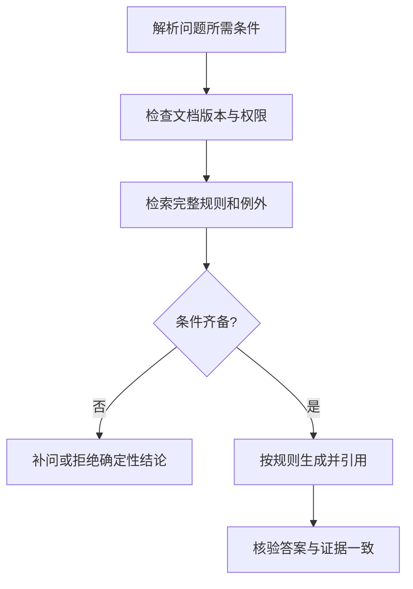

# 187｜从“召回命中”到“答案可信”还差几步

> **场景引入**：系统命中退费政策，但用户套餐类型和权益使用状态未知。相关文档无法替代这些个案条件。

> 对应[原始材料](../origanl/187-RAG召回正确大模型为何答错？.md)。

---

## 🎯 一句话定位

先判断证据与用户状态是否齐全，再生成并核验有引用支持的答案。

## 💎 核心要点概览

| 检查 | 不满足时 |
| --- | --- |
| 规则版本适用 | 查当前有效版 |
| 个案条件齐全 | 补问或调用授权工具 |
| 引用支持结论 | 修正或拒答 |

## 🚀 核心总结

> 召回命中只是证据候选，不能保证个案可回答。

---

## 一、先判断能否回答

会员退费场景中，命中一篇正确政策仍可能缺套餐类型、购买日期或权益使用状态。仅有相关片段，不能保证结论成立。要把“证据足够吗”“证据怎样组合”“答案有没有忠实引用”分开验证。

若某条政策只适用于“普通会员”，用户却是“促销会员”，不能因相似度高就套用。若版本已过期，要查生效范围；若数据库里有用户状态，应通过授权工具读取，而不是要求模型从聊天中推测。

评测可分别报告：正确证据召回率、必要条件覆盖率、引用准确率和错误肯定结论率。这样能知道失败是数据治理、检索还是生成。

**面试表达：**“我先做可回答性判断，再把完整条款与用户状态匹配，最后核验结论是否由引用支持。”

---

## 二、落地 Checklist

- [ ] 把政策适用条件与用户实时状态逐项匹配。
- [ ] 区分证据召回、条件覆盖和引用准确率。
- [ ] 缺关键条件时补问，不给错误肯定结论。

## 三、总结（一句话带走）

> **答得可信，要先有完整规则和完整个案事实。**
