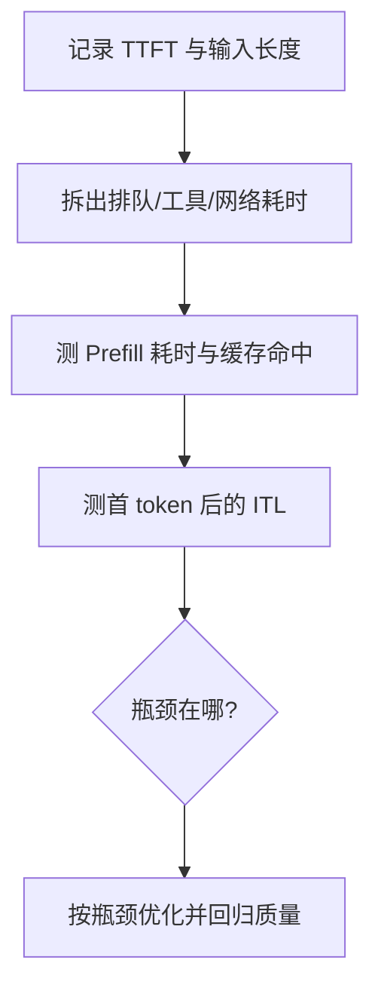

# 188｜首字延迟为何常受 Prefill 影响

> **场景引入**：长文档问答首字慢，可能是输入处理耗时，也可能是高峰期排队。只盯 Prefill 会漏掉其他阶段。

> 对应[原始材料](../origanl/188-首字延迟为什么看Prefill.md)。

---

## 🎯 一句话定位

Prefill 是首 token 前的必要计算，是否为主瓶颈仍要用分段计时确认。

## 💎 核心要点概览

| 指标 | 排障价值 |
| --- | --- |
| TTFT | 用户感知首字等待 |
| Prefill | 输入计算耗时 |
| 排队与缓存 | 高峰和复用效果 |

## 🚀 核心总结

> 长输入常增加 Prefill 成本，但端到端首字还受调度和网络影响。

---

## 一、从请求到首 token

Prefill 要先处理输入序列，生成后续解码所需的内部缓存；输入越长，通常需要越多计算。但端到端 TTFT 还受排队、Batch 调度、缓存命中、网络和工具调用影响，所以“首字只看 Prefill”是不完整的。

若长文档请求 TTFT 高、Prefill 占大头，可减少无关文档、优化缓存或换更合适的上下文策略。若高峰期所有请求 TTFT 同时变差，先看队列与并发。Batch 可以提高吞吐，却可能让个别请求等待更久，需同时看 P95 时延。

KV Cache 能减少后续 token 的重复计算，但增加显存占用；资源不足时又可能影响调度。性能优化应与答案正确率一起验证。

**面试表达：**“Prefill 是首 token 的必要阶段，但我会先用分段计时确认是否真是主瓶颈。”

---

## 二、落地 Checklist

- [ ] 按输入长度和并发量分组记录 TTFT 与 Prefill。
- [ ] 同时记录排队、工具、网络和缓存命中。
- [ ] 优化后回归答案质量和 P95。

## 三、总结（一句话带走）

> **Prefill 值得看，但要先证实它占了多少时间。**
