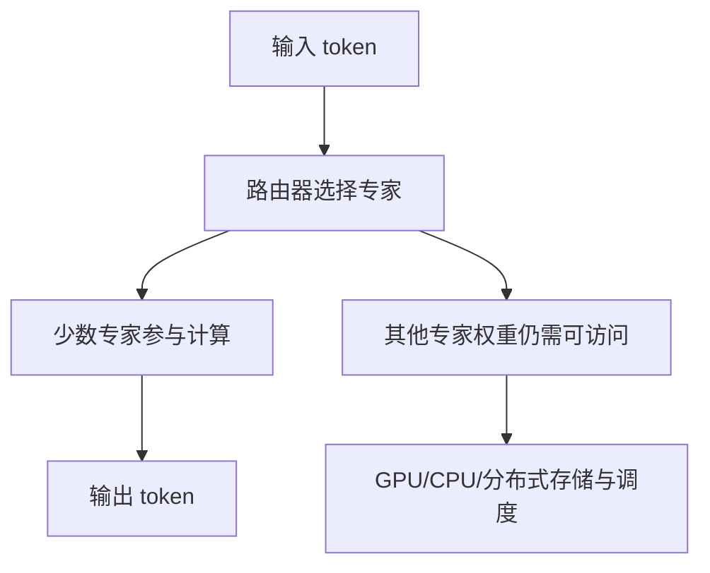

# 189｜MoE 每次只激活少数专家，为何仍占显存

> **场景引入**：模型标称每 token 只激活一部分参数，部署时 GPU 显存仍很高。计算量与权重驻留量不是一回事。

> 对应[原始材料](../origanl/189-MoE激活少为何显存占用大？.md)。

---

## 🎯 一句话定位

MoE 的稀疏激活减少部分计算，显存仍取决于专家权重驻留、缓存和并发。

## 💎 核心要点概览

| 概念 | 影响 |
| --- | --- |
| 激活参数 | 每 token 的计算 |
| 驻留权重 | 显存与访问速度 |
| KV Cache | 长上下文和并发显存 |

## 🚀 核心总结

> 卸载或分片可降单卡显存，但会增加通信和延迟。

---

## 一、计算稀疏不等于存储稀疏

MoE 路由器对每个 token 选少数专家参与计算，因此每 token 的专家计算量低于“所有专家都算”。但部署需能快速访问可能被选中的专家权重；若全放 GPU，显存仍接近总驻留权重加 KV Cache 等开销。

“所有专家必须常驻单张 GPU”也不准确：可以跨 GPU 分片、卸载到 CPU 或按需加载，但这会换来通信、带宽或延迟成本。显存预算还包含共享层权重、路由器、激活、KV Cache、并发缓冲和框架开销。估算时区分总参数、激活参数与实际驻留参数。

例如模型宣传“每 token 激活 20B 参数”，不能据此推断只需容纳 20B 的权重；要看所有专家如何部署及目标吞吐。

**面试表达：**“激活参数决定部分计算量，显存取决于权重驻留与缓存；卸载或分片可降单卡占用，但会增加访问成本。”

---

## 二、落地 Checklist

- [ ] 区分总参数、激活参数和实际驻留参数。
- [ ] 显存预算包含共享层、专家、KV Cache 和并发缓冲。
- [ ] 对比卸载、分片的显存收益与延迟代价。

## 三、总结（一句话带走）

> **少算几个专家，不等于只需存这几个专家。**
