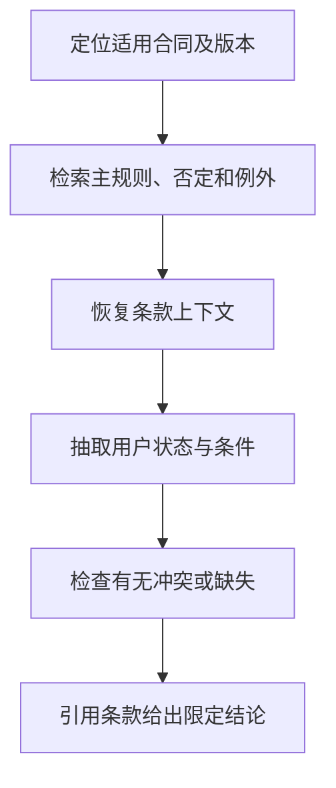

# 190｜RAG 如何避免漏读“不得退款”

> **场景引入**：条款说定制服务不得退款，但未开始制作的除外。用户没说制作是否开始，系统就不能直接给可退或不可退结论。

> 对应[原始材料](../origanl/190-RAG为何无视 不得退款 ？.md)。

---

## 🎯 一句话定位

否定条款要连同适用对象、例外和用户状态一起核对。

## 💎 核心要点概览

| 信息 | 作用 |
| --- | --- |
| 主规则 | 默认限制 |
| 例外 | 改变部分场景结论 |
| 用户状态 | 判断个案落在哪一侧 |

## 🚀 核心总结

> 既不能把“不得”当绝对规则，也不能只凭“除外”认定可退。

---

## 一、保留否定与例外的完整范围

检索“退款”可能拿到多个主题相关片段，其中“支持退款”“不得退款”意思相反。错误不一定发生在向量层：切片、版本过滤、重排和答案生成都可能丢掉限定条件。

例：“定制服务不得退款，未开始制作的除外。”用户只说“定制服务”，还缺是否开始制作。系统应问清或查业务状态，而非把“不得退款”当绝对规则，也不能只凭“除外”认定可退。

上线前用包含“不予、除非、仅限、未”等真实条款的测试集，测错误批准率与条件遗漏率。对于争议条款保留人工审核通道。

**面试表达：**“我确保否定词连同作用对象、条件和例外进入证据链，再按用户状态判断，无法确定就澄清。”

---

## 二、落地 Checklist

- [ ] 检索完整条款、否定对象和例外。
- [ ] 通过授权工具确认用户业务状态。
- [ ] 评测错误批准率和条件遗漏率，争议转人工。

## 三、总结（一句话带走）

> **否定范围和例外都齐了，才能判断具体个案。**
