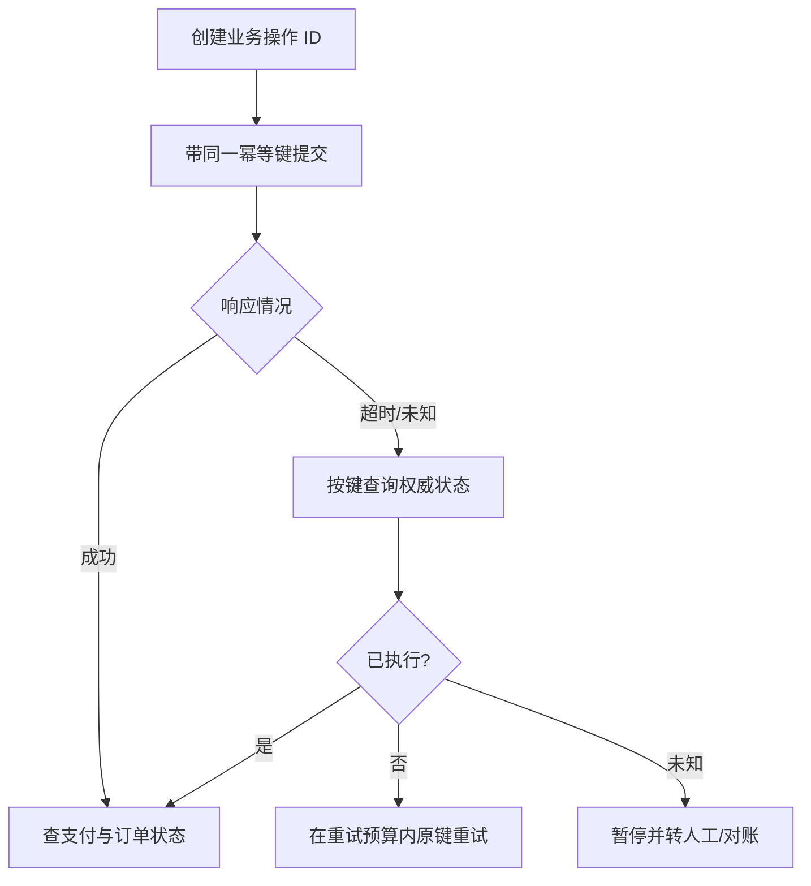

# 191｜扣款重试：区分接口结果与业务结果

> **场景引入**：支付接口超时、订单表未更新，但支付平台可能已经扣款。接口响应和最终业务结果必须分开确认。

> 对应[原始材料](../origanl/191-Agent如何避免重复扣款？（重发）.md)。参考 [Stripe 幂等请求](https://docs.stripe.com/api/idempotent_requests)。

---

## 🎯 一句话定位

超时先查权威状态，同一业务操作沿用稳定幂等键，最终以对账确认。

## 💎 核心要点概览

| 状态 | 含义 |
| --- | --- |
| HTTP 超时 | 客户端不知道结果 |
| 支付成功响应 | 平台已有处理结果 |
| 订单完成 | 内部记账与支付一致 |

## 🚀 核心总结

> 三种状态不能混为一谈，未知结果不能靠模型猜。

---

## 一、三种状态不能混淆

HTTP 超时代表客户端不知道结果；支付接口返回成功代表平台受理或处理成功；订单完成还要看内部记账与对账。Agent 不应把任何一种状态自动等同最终业务成功。

幂等键由业务层生成并持久化，不能让模型每次重试随机生成。键要绑定金额、币种、订单与收款方；同键参数不一致必须拒绝。支付平台的幂等保留时长和返回语义各不相同，调用前应查对应平台文档。

故障演练覆盖“扣款成功但响应丢失”“平台失败但订单已更新”“重复回调”，并检验最终只产生一笔有效扣款。

**面试表达：**“超时先查权威状态；同一业务操作使用同一幂等键，最终通过对账确认结果。”

---

## 二、落地 Checklist

- [ ] 业务层持久化幂等键并绑定交易参数。
- [ ] 超时按键查平台状态，未知则暂停或对账。
- [ ] 演练响应丢失、重复回调和两边状态不一致。

## 三、总结（一句话带走）

> **扣款以权威交易和对账结果为准。**
