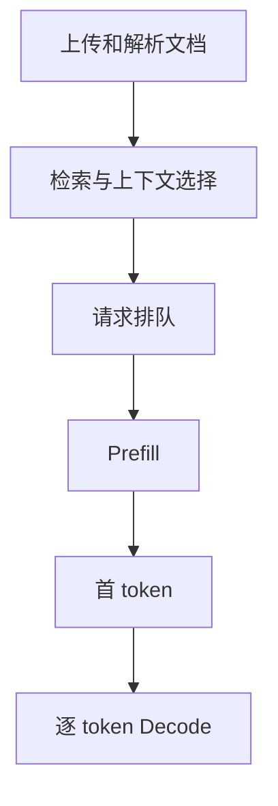

# 192｜长文档问答为什么迟迟不出首字

> **场景引入**：用户上传长文档后一直等首字。慢可能发生在解析、检索、排队或模型 Prefill，须逐段测量。

> 对应[原始材料](../origanl/192-首字延迟的底层逻辑.md)。

---

## 🎯 一句话定位

长文档问答的首字时间是整条链路的结果，不能只看模型 Prefill。

## 💎 核心要点概览

| 阶段 | 可优化点 |
| --- | --- |
| 解析与检索 | 缓存、选择证据段 |
| 排队 | 容量与调度 |
| Prefill | 控制无关输入 |

## 🚀 核心总结

> 分段计时后再优化，并复测答案完整性。

---

## 一、首字前发生了什么

系统先解析文档、检索与组装上下文，再经网络和队列进入模型；模型 Prefill 处理输入并准备 KV Cache 后，才开始输出首 token。长文档可能使 Prefill 增加，但也可能是文档解析或排队占主要时间。

排障时记录解析、检索、排队、Prefill 和 Decode 的分段时间，并按文档长度与并发量分组。若重复问同一文档，缓存解析结果或可复用前缀可能有效；若每次输入都包含无关全文，应选择证据段并保留引用。压缩内容后必须复测答案完整性。

用户体验可先显示“正在检索证据”这类真实进度，但这不改变模型 TTFT；报告性能时别把 UI 反馈当首 token 输出。

**面试表达：**“我按端到端链路拆解首字等待，确认 Prefill 是否主因，再用真实请求分组验证优化。”

---

## 二、落地 Checklist

- [ ] 记录解析、检索、排队、Prefill 和 Decode 时间。
- [ ] 按文档长度与并发量分组分析。
- [ ] UI 进度与真实首 token 指标分别报告。

## 三、总结（一句话带走）

> **首字前每一步都可能慢，测清楚再动手。**
