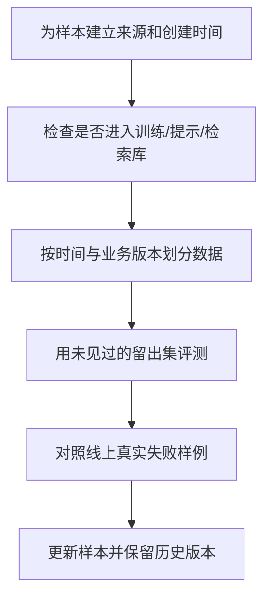

# 193｜Agent 评测集污染如何识别

> **场景引入**：公开题得分很高，换个问法就失误；某些标准答案还来自旧制度。高分可能来自题目泄漏或答案过期。

> 对应[原始材料](../origanl/193-Agent评测集被污染怎么识别？.md)。

---

## 🎯 一句话定位

追踪样本是否进入提示、检索或调参流程，并核对标准答案的业务版本。

## 💎 核心要点概览

| 问题 | 检查 |
| --- | --- |
| 题目泄漏 | 样本血缘和接触记录 |
| 答案过时 | 制度和数据版本 |
| 泛化不足 | 未见过的时间留出集 |

## 🚀 核心总结

> 评测高分只有在样本独立、答案仍有效时才有解释力。

---

## 一、两类“高分假象”

其一，评测题或答案曾进入 Few-shot、知识库、调参记录，系统可能记住答案；其二，题目已过时，例如制度版本改变，旧“标准答案”不再正确。两者都可造成离线高分与线上表现脱节。

发现信号包括：公开题表现异常高、轻微改写后骤降、模型能复述标准答案却不能解释执行路径、近期业务变更后仍按旧答案通过。检查样本血缘和使用记录，比凭分数猜污染更可靠。

评测集应有隔离权限、版本和禁用列表。可定期加入时间上较新的、人工审核的题，并报告按版本分层的结果。线上失败案例回灌前要脱敏，且避免马上用于同一留出集的调参。

**面试表达：**“我追踪评测样本是否被系统接触过，也核查标准答案是否过时；用隔离的时间留出集验证泛化。”

---

## 二、落地 Checklist

- [ ] 样本记录来源、创建时间、业务版本和使用范围。
- [ ] 隔离留出集，检查是否进入 Few-shot 或知识库。
- [ ] 定期加入较新的人工审核样例并分层报告。

## 三、总结（一句话带走）

> **评测分数要连同样本血缘和答案时效一起看。**
