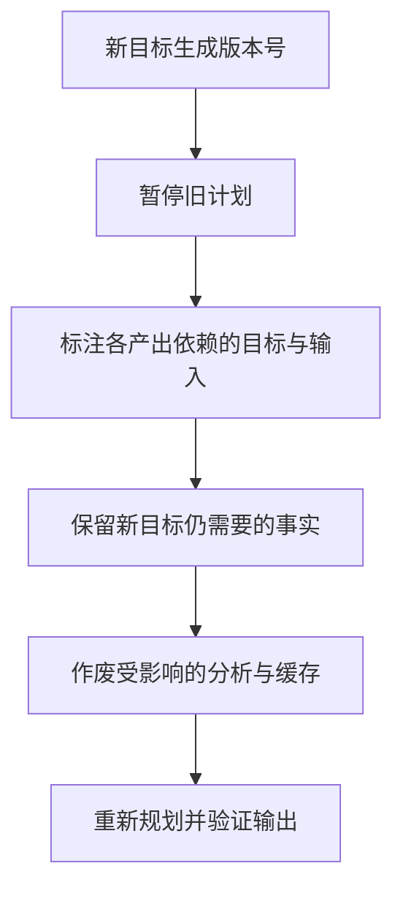

# 194｜用户改目标时，怎样精确作废旧状态

> **场景引入**：用户把竞品价格报告改成口碑报告。竞品名单也许能复用，价格分析却应作废；若已发邮件，还需单独处理外部影响。

> 对应[原始材料](../origanl/194-用户中途改目标怎么办？.md)。

---

## 🎯 一句话定位

目标变化后按依赖图判断中间产出的有效性，并单独处理已发生副作用。

## 💎 核心要点概览

| 产出 | 处理原则 |
| --- | --- |
| 仍服务新目标的事实 | 可复用，需核对来源 |
| 依赖旧目标的分析 | 作废并重算 |
| 已发布或已付款 | 查状态并补偿 |

## 🚀 核心总结

> 全清空浪费事实，全保留会污染新目标，关键是记录依赖。

---

## 一、用依赖关系决定保留什么

用户让 Agent 从“竞品价格报告”改做“竞品口碑报告”。竞品名单可能继续有效，价格抓取和价格分析则不再服务于新目标。全清空会浪费可用事实；全保留会污染新报告。

每个中间产出记录 `goal_version`、输入来源和依赖节点。竞品名单可复用，但若名单本来按“低价竞品”筛出，也可能需要重查。已对外发送的邮件或已付款订单不能靠“作废缓存”撤销，需明确补偿和告知流程。

用户确认也有范围：对旧价格报告的确认不能自动授权新口碑报告发布。重规划后需要重新评估权限和关键动作。

**面试表达：**“我按目标版本和依赖图失效旧产出，保留仍有效的事实，并单独处理已发生的外部副作用。”

---

## 二、落地 Checklist

- [ ] 新目标生成版本号并暂停旧计划。
- [ ] 中间产出记录目标版本、来源和依赖节点。
- [ ] 对旧确认和外部副作用重新评估授权与补偿。

## 三、总结（一句话带走）

> **按依赖作废旧状态，真实世界动作另行核对。**
