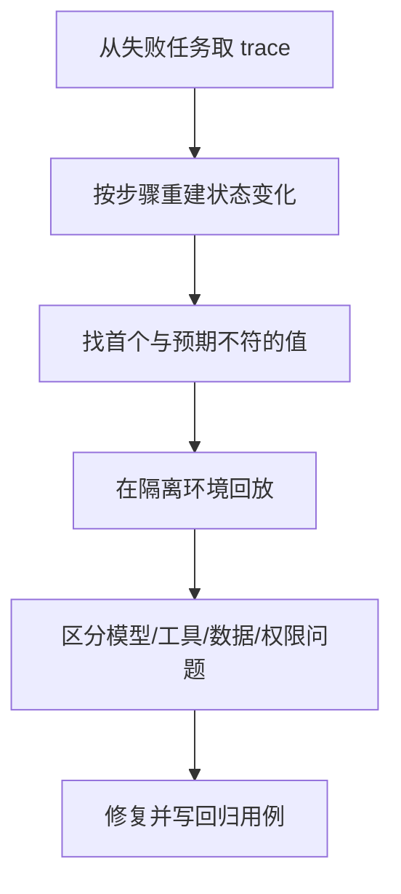

# 195｜多工具调用失败，如何复现与定位

> **场景引入**：工具返回 `accepted`，模型却告诉用户“付款已完成”。接口没有报错，错误出在对业务状态的解释。

> 对应[原始材料](../origanl/195-Agent工具调用失败怎么排查.md)。

---

## 🎯 一句话定位

保存步骤级 trace 和版本快照，找首个错误状态，再安全回放验证修复。

## 💎 核心要点概览

| 资料 | 作用 |
| --- | --- |
| Trace | 还原因果链 |
| 快照 | 固定提示、模型、工具版本 |
| 回放 | 在隔离环境复现故障 |

## 🚀 核心总结

> 工具成功不等于业务完成，必须核对返回语义与真实状态。

---

## 一、Trace、快照、回放

多步流程的最后一步报错，根因可能在更早的状态转换。需要把每步模型选择、工具参数、工具真实返回和业务状态串成链路，并保存足够的快照供安全回放。

例如工具返回 `status=accepted`，模型却解读成“付款已完成”，后续步骤因此跳过查单。接口本身没有报错，错误发生在结果解释。应记录工具返回的原始状态码与规范化业务状态，不能只存一句“调用成功”。

回放时固定 Prompt、模型版本、工具 schema 和输入快照；写工具使用模拟环境，避免回放重复下单。敏感数据按权限脱敏。

**面试表达：**“我借 trace 定位首个错误状态，利用快照安全复现，然后把失败链路变成回归样例。”

---

## 二、落地 Checklist

- [ ] 记录模型选择、工具原始返回和规范化业务状态。
- [ ] 固定提示、模型、schema 和输入快照。
- [ ] 写工具回放使用替身，防止重复真实动作。

## 三、总结（一句话带走）

> **先复原首个错误状态，再修复后续连锁反应。**
