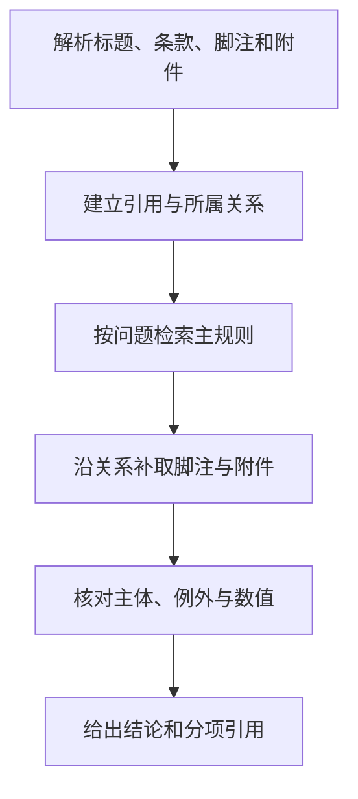

# 196｜正文、脚注、附件分散时如何组证据

> **场景引入**：招标正文写注册资本门槛，脚注说联合体例外，附件列供应商资质。缺任何一处都可能误判。

> 对应[原始材料](../origanl/196-RAG怎么处理复杂文档证据链？.md)。

---

## 🎯 一句话定位

入库保留正文、脚注、附件的结构关系，检索时沿引用补齐证据。

## 💎 核心要点概览

| 证据槽位 | 来源 |
| --- | --- |
| 门槛 | 正文条款 |
| 是否适用 | 脚注例外 |
| 实际值 | 附件表格 |

## 🚀 核心总结

> 文档结构决定条款如何共同生效，不能把片段当孤立句子。

---

## 一、文档结构本身就是信息

招标正文要求注册资本 500 万以上，脚注说明联合体不适用，附件列供应商资质。若切片只保存正文，系统可能误判联合体不合格；只看附件也不知道适用规则。

入库要保留页码、条款号、脚注锚点、附件编号与表格行列。检索命中主条款后可沿文档结构补取相关脚注；但不能无差别追加整份附件。多份文件拼接时还要确认招标批次、版本和供应商相同。

可用“证据槽位”验收：门槛、是否适用、供应商实际值三个槽位都齐全才给确定结论；缺一项就说明缺口。引用应指向原文位置，方便人工复核。

**面试表达：**“复杂文档要保留结构关系并做关联召回，最终按证据槽位检查完整性和适用性。”

---

## 二、落地 Checklist

- [ ] 保存页码、条款、脚注锚点、附件与表格行列。
- [ ] 命中主条款后沿关系补取必要关联证据。
- [ ] 核对批次、版本、主体和三个证据槽位。

## 三、总结（一句话带走）

> **正文、脚注和附件是一条证据链。**
