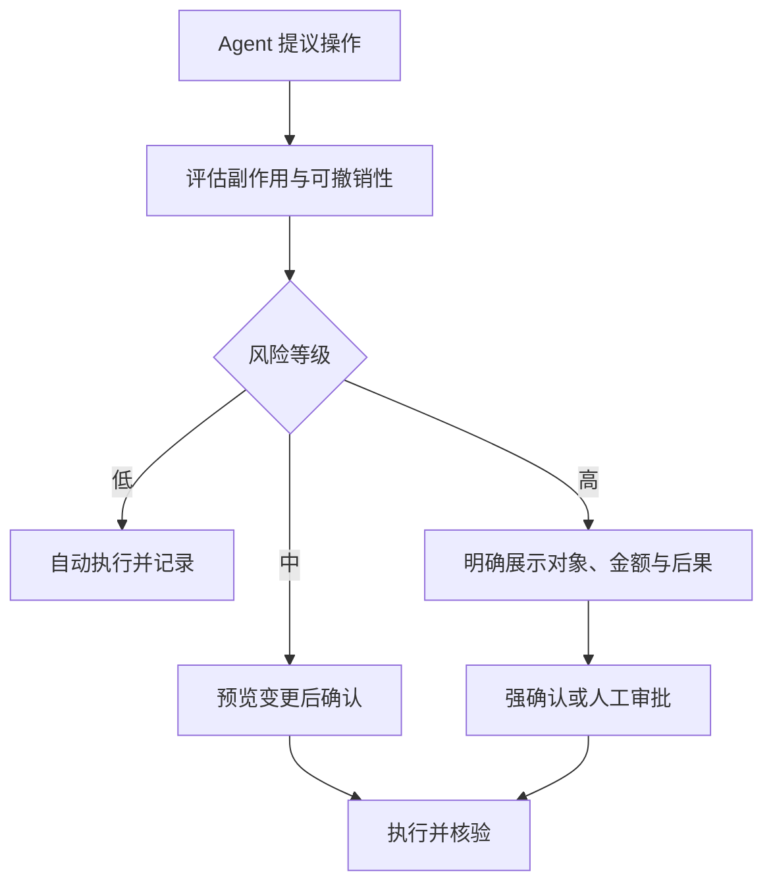

# 197｜Agent 何时需要用户确认

> **场景引入**：同样叫“更新”，编辑草稿与修改已提交的银行卡信息后果完全不同。确认等级应按实际影响决定。

> 对应[原始材料](../origanl/197-操作确认与风险分级.md)。

---

## 🎯 一句话定位

按动作后果、可撤销性、金额和影响对象，选择自动、预览确认或强审批。

## 💎 核心要点概览

| 级别 | 示例 | 控制 |
| --- | --- | --- |
| 低 | 读取制度 | 自动留痕 |
| 中 | 修改草稿 | 预览确认 |
| 高 | 付款、改账户 | 强确认或审批 |

## 🚀 核心总结

> 具体参数必须进入确认记录，变化后旧确认失效。

---

## 一、按后果分级，而非按工具名

查报销制度是读取；生成草稿通常可撤销；提交审批、改银行卡或付款会产生外部后果。确认频率应随风险、可撤销性、金额、权限和受影响对象变化。

“更新”同一个工具可能用于编辑草稿，也可能用于改已提交的支付信息，风险不同。确认页面应展示具体对象和参数，而非泛泛问“是否继续”。确认应绑定操作摘要与版本，参数变化后旧确认失效。

系统策略负责拦截高风险动作，不能只靠模型自觉请求确认。执行后记录审计信息并核查业务状态；可撤销动作也要明确撤销窗口。

**面试表达：**“我按动作后果设计自动、预览确认和强审批三级，并让确认绑定具体参数，避免确认疲劳与越权。”

---

## 二、落地 Checklist

- [ ] 后端按副作用和可撤销性判风险级别。
- [ ] 确认展示对象、金额、范围与后果。
- [ ] 绑定参数版本，执行前再次鉴权和核验。

## 三、总结（一句话带走）

> **确认跟着风险走，审批跟着具体参数走。**
