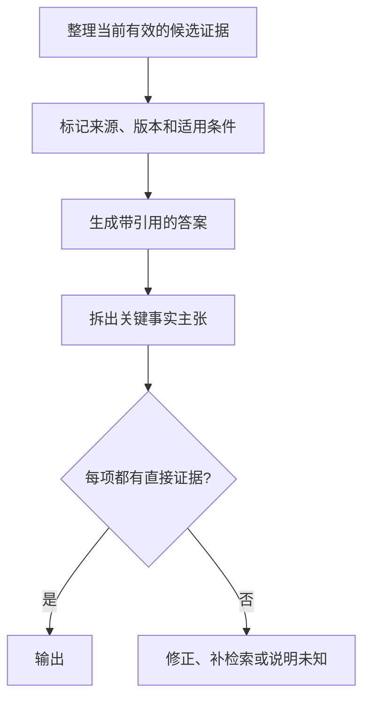

# 198｜召回正确，如何保证答案忠实于证据

> **场景引入**：证据只支持“普通套餐 72 小时内可退”，模型却答“所有用户都可退”。结论范围超过了证据范围。

> 对应[原始材料](../origanl/198-RAG召回正确模型却答错？.md)。

---

## 🎯 一句话定位

把答案拆为可核查主张，逐项比对引用和适用条件。

## 💎 核心要点概览

| 主张要素 | 核对内容 |
| --- | --- |
| 对象 | 套餐、用户、地区 |
| 时间 | 有效期与申请期限 |
| 条件 | 例外、否定和金额 |

## 🚀 核心总结

> 有引用链接不等于引用支持了答案的完整范围。

---

## 一、“看见证据”与“按证据回答”不同

正确片段已在 Prompt 中，旁边却有过期 FAQ 和类似但不适用的例外。模型可能给出流畅却错误的结论。需要把最终答案拆成可核查主张，并逐项匹配证据。

例如回答“所有用户可退款”，引用却只支持“普通套餐 72 小时内可退款”，就是主张范围大于证据范围。核验器应检查对象、时间、金额、条件与否定，而不是只看引用链接是否存在。

评测可设计“正确证据与干扰证据同时出现”的题，观察条件遗漏和无证据扩张。必要时先用结构化规则算出结论，再由模型解释。

**面试表达：**“重排证据只是第一步，我还会对答案的每个关键主张做引用与适用范围核验。”

---

## 二、落地 Checklist

- [ ] 标注当前有效证据的来源、版本和条件。
- [ ] 检查每个答案主张是否有直接支持。
- [ ] 用正确证据加干扰证据的样例测范围扩张。

## 三、总结（一句话带走）

> **答案不能说得比证据更宽。**
