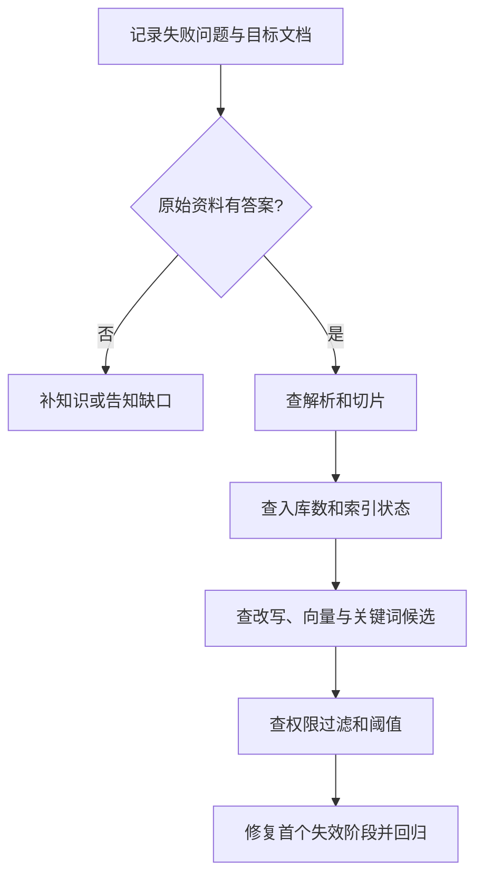

# 199｜零召回：知识缺口还是检索事故

> **场景引入**：系统零召回，原始资料里其实也没有该问题的答案。调 `top_k` 不能凭空造出知识。

> 对应[原始材料](../origanl/199-RAG零召回怎么排查？千万别只调topK.md)。

---

## 🎯 一句话定位

先确认原始资料是否有答案，再沿解析、索引、检索和过滤定位系统故障。

## 💎 核心要点概览

| 情况 | 处理 |
| --- | --- |
| 原文无答案 | 补知识或告知缺口 |
| 原文有、索引无 | 查解析和入库 |
| 候选被过滤光 | 查权限与元数据 |

## 🚀 核心总结

> 区分知识缺口和检索事故，才能修对地方。

---

## 一、先分两种情况

若知识库确实没有答案，调检索参数也无法造出事实；若原文有答案但系统找不到，则是解析、索引、过滤或查询链路的问题。首先通过原始资料或业务负责人确认“答案是否存在”。

“上传成功”不代表解析和索引成功；异步管道可能部分失败。检查文档 ID、解析页数、切片数、向量数和索引更新时间。若候选在权限过滤后归零，应修复标签或用户权限，绝不能简单移除过滤。

`top_k` 只控制取多少已有候选，无法解决原文缺失、索引为空或错误权限。上线监控应区分知识缺口率与系统零召回率。

**面试表达：**“我先确认知识是否存在，再沿入库、查询、检索和过滤逐段核对数量，定位检索事故。”

---

## 二、落地 Checklist

- [ ] 让原始资料或业务负责人确认答案是否存在。
- [ ] 查文档 ID、解析页数、切片数、索引时间和候选数。
- [ ] 分别监控知识缺口率与系统零召回率。

## 三、总结（一句话带走）

> **先判有没有知识，再查系统为何找不到。**
