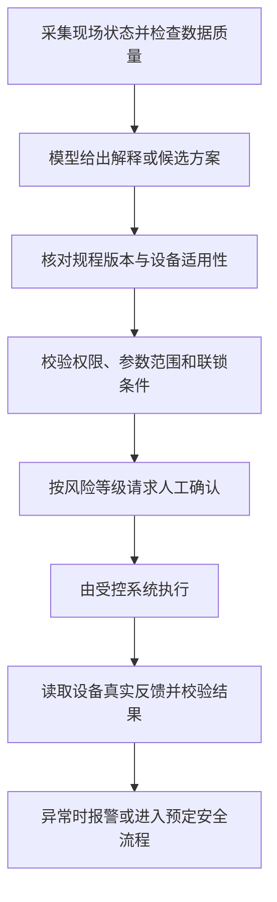

# 20. 工业级 Agent 怎么设计？先做实安全边界与执行闭环

> **场景引入**：系统建议调整设备参数。即使建议文字正确，也不能直接写入控制器：设备型号、现场工况、允许范围和操作者权限都可能不同。

> 对应原稿：[20-工业级Agent怎么设计？先做实安全边界与执行闭环](../origanl/20-工业级Agent怎么设计？先做实安全边界与执行闭环.md)。本文讨论架构思路；涉及真实设备时，方案须按现场安全要求设计和验证。

---

## 🎯 一句话定位

**工业场景要先确定哪些动作可以自动化、谁有执行权、异常时怎样进入安全状态，再讨论模型能提供什么帮助。** 大模型适合解释资料、辅助分析和提出候选方案；设备的安全联锁、参数范围和最终执行权应由经过验证的控制与授权机制掌握。

---

## 💎 核心要点概览

| 层次 | 要求 |
| --- | --- |
| 模型建议 | 标明数据来源、设备型号与适用工况 |
| 执行前 | 权限、参数范围、设备状态和规程版本由系统校验 |
| 高风险动作 | 现场授权、人工确认和安全联锁 |
| 执行后 | 读取设备反馈，不以接口“已受理”当成功 |
| 异常时 | 进入预设报警、降级或安全状态 |

---

## 🚀 核心总结

> **模型可以辅助判断，设备安全边界与最终执行权必须由可验证的控制系统掌握。**

---

## 一、为什么工业 Agent 不等于聊天机器人

客服答错一句话可能引发投诉；生产设备接到错误指令可能导致停机、设备损坏甚至人员受伤。两者的差异是**动作后果**。美国 NIST 的 [OT 安全指南](https://csrc.nist.gov/pubs/sp/800/82/r3/final)强调，工业控制需要同时考虑性能、可靠性与安全；其 [安全仪表系统定义](https://csrc.nist.gov/glossary/term/safety_instrumented_system)也说明，安全状态应由专门的传感、逻辑和执行机制保障。

因此不能把检索到的说明书直接变成设备指令。即使资料内容正确，也可能版本不适用、设备型号不匹配，或现场工况已改变。

## 二、一条可控的执行链

假设系统建议“降低某台设备的运行负载”。从建议到执行，应经过：

这是一条概念流程，实际系统应按设备、工艺与现场标准具体设计。尤其要分清**发出指令**和**设备完成动作**：接口返回“已接收”，不表示执行结果达标。必须通过可信的设备状态或反馈信号核实。

## 三、先回答四个设计问题

| 问题 | 需要明确的内容 |
| --- | --- |
| 出错会怎样？ | 是否影响人员安全、设备、环境或产线 |
| 谁能执行？ | 哪些角色可批准，模型只能建议还是能触发低风险动作 |
| 何时不能继续？ | 传感器异常、证据不足、断网、规则冲突时的处置 |
| 怎样证明执行成功？ | 实际状态、反馈时限、偏差阈值、审计记录 |

不同任务需要不同的响应要求：分析日报可以等待，某些设备控制必须由现场实时系统处理。不能给所有“工业 Agent”套一个统一的毫秒指标。

## 四、故障与断网要预先决定

断网、传感器失真、工具超时不能留给模型临场发挥。系统应事先规定哪些能力降级、哪些动作停止、何时由现场人员接管。已发生的物理操作未必能撤销，所以高风险动作应把校验和确认放在执行前。

日志至少关联输入数据来源、模型建议、使用的规程版本、放行的规则、审批人、执行命令与设备实际反馈。这样才能区分是数据、模型、规则、接口还是设备出了问题，也方便把事故或近失事件转成回归案例。

## 五、面试口述版

> 我会先做风险分级，明确模型的职责与执行边界。模型主要提供分析和候选建议，设备安全联锁与最终放行由确定性控制系统负责。执行前校验数据质量、规程版本、设备状态、权限和参数范围；高风险动作要求人工确认。执行后读取设备真实反馈，失败时进入预设的报警、降级或安全流程，并保留完整审计链路。框架能编排步骤，但不能替代现场安全设计。

**自测：**设备接口说“命令已接收”，为什么仍不能标记任务成功？断网时哪些决定必须事先写好？

**一句话带走：工业 Agent 的能力边界，应由可验证的安全系统来画。**

---

## 六、生产环境 Checklist

- [ ] 设备型号、规程版本、数据新鲜度和现场状态可核对。
- [ ] 模型输出不会直接绕过控制器的安全联锁与参数限制。
- [ ] 高风险动作需明确授权和人工确认。
- [ ] 命令受理与设备实际完成分开记录。
- [ ] 断网、传感异常与执行失败有预设安全状态。

## 七、总结（一句话带走）

> **工业 Agent 首先是受控执行系统，其次才是智能建议系统。**
