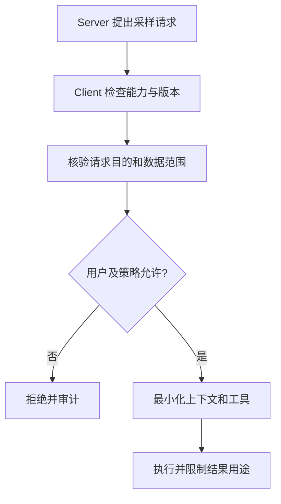

# 200｜MCP Sampling：谁有权决定上下文

> **场景引入**：服务端请求总结合同选中页，却试图获得其他客户合同和写工具。客户端必须按用户授权限制请求范围。

> 对应[原始材料](../origanl/200-MCP采样权限边界怎么设计.md)。[MCP Ruby SDK 文档](https://ruby.sdk.modelcontextprotocol.io/server/sampling/)指出 Sampling 在 2026-07-28 版本已弃用；旧版仍需严格处理权限边界。

---

## 🎯 一句话定位

旧版 Sampling 中，服务端可请求模型调用，客户端决定是否授权及提供哪些上下文。

## 💎 核心要点概览

| 边界 | 控制方 |
| --- | --- |
| 协议能力与版本 | 客户端核对 |
| 数据与工具范围 | 用户和客户端策略 |
| 结果用途 | 客户端限制与审计 |

## 🚀 核心总结

> 请求能力不等于授权能力，服务端文本仍是低信任输入。

---

## 一、服务端能请求，不能自行授权

在支持 Sampling 的旧版连接中，MCP Server 可请求客户端使用模型。但是否调用、给模型哪些数据和工具、结果是否回传，应由客户端按用户授权决定。Server 提供的文本仍是低信任输入，不能借此读取整个会话或系统提示词。

例如“总结所选合同页”，客户端只提供那几页及必要指令，不提供其他客户合同、访问 token 或任意写工具。结果返回也应受用途限制；模型输出不能自动触发付款或删除。

协议版本升级时，先核对客户端与服务端实际支持能力，再选择当前推荐的模型调用方式，不应把旧 Sampling 流程当作默认设计。

**面试表达：**“权限由客户端和用户策略决定；即使旧版协议允许反向采样，也必须做上下文最小化和审计。”

---

## 二、落地 Checklist

- [ ] 确认协议版本及 Sampling 支持状态。
- [ ] 客户端核对目的、数据范围、工具和用户授权。
- [ ] 审计结果流向，禁止模型输出自动获得执行权。

## 三、总结（一句话带走）

> **客户端掌握上下文和权限的最终决定权。**
