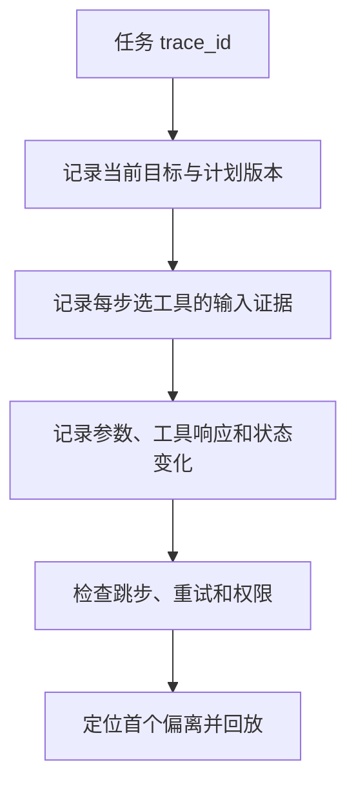

# 201｜工具链路报错，为什么需要步骤级 Trace

> **场景引入**：订单 Agent 跳过库存检查，最后短信接口报错。只记末尾异常无法解释为什么先前步骤被跳过。

> 对应[原始材料](../origanl/201-Agent连续调用工具报错怎么查？.md)。

---

## 🎯 一句话定位

将动态决策、工具调用和状态转移连到同一 trace，找首次偏离。

## 💎 核心要点概览

| 记录 | 用途 |
| --- | --- |
| 目标与计划版本 | 判断为何选这一步 |
| 参数与工具结果 | 判断执行是否正确 |
| 业务状态 | 验证动作是否真实完成 |

## 🚀 核心总结

> 不必记录不可见的内部思考，要记录可审计的输入、决策摘要和执行事实。

---

## 一、动态决策也要可追溯

订单 Agent 执行“查订单→查库存→发券→发短信”，若跳过库存，最后即使短信接口报错，根因可能是模型选错路径。日志只记录最终异常，不能解释为何跳步。

Trace 不一定保存模型内部不可见的“思考”；应记录可审计的决策摘要、可见输入、工具请求和结果。工具成功要再核对业务状态，模型说“已发券”不能代替券系统记录。回放时对写操作使用模拟接口，并固定提示词和工具版本。

指标除最终成功率外，还可看非法跳步率、工具参数错误率、重试次数和人工接管率。对敏感请求做脱敏和访问控制。

**面试表达：**“把动态决策、工具调用和状态转移接进同一 Trace，寻找首次偏离的步骤，而非只看最后报错。”

---

## 二、落地 Checklist

- [ ] 每步记录可见输入、工具参数、返回和状态变化。
- [ ] 查非法跳步、参数错误、重试与权限拒绝。
- [ ] 脱敏回放写工具时使用模拟接口。

## 三、总结（一句话带走）

> **动态路径也要能沿 trace 解释和复现。**
