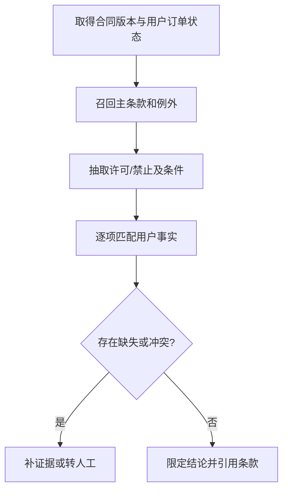

# 202｜合同 RAG 把“不得退款”答成可退，怎样修

> **场景引入**：合同只允许质量问题退货，用户说“不满意”。系统不能把主观不满意直接当作已鉴定的质量问题。

> 对应[原始材料](../origanl/202-合同RAG为何把不得退款答成可退？.md)。

---

## 🎯 一句话定位

恢复完整否定条款和例外，再逐项匹配用户事实，给限定结论。

## 💎 核心要点概览

| 要素 | 核对 |
| --- | --- |
| 主规则 | 默认禁止什么 |
| 例外 | 什么条件下可申请 |
| 个案事实 | 用户是否满足条件 |

## 🚀 核心总结

> 主题相关的片段不一定支持“可退”这一结论。

---

## 一、相关片段不是支持性证据

“不得退款”“仅质量问题可退”“逾期不可退”都与退款相关，但适用条件不同。检索阶段的相似度无法直接回答“这个用户能否退”。要恢复完整条款并比对用户事实。

例如“定制服务不得退款，但质量问题可申请退货”。用户只说“不满意”，不能自动判为质量问题；如果已鉴定存在质量问题，也不能只读前半句拒绝。系统应引用适用的条款和鉴定事实，缺事实则说明条件。

可将输出做结构化校验：结论、适用对象、限制条件、证据页码。把误答“可退”的高风险样例纳入回归，并由业务/法务审核规则解释。

**面试表达：**“先区分主题相关与结论支持，完整解析否定、例外和用户状态，再给可追溯的限定结论。”

---

## 二、落地 Checklist

- [ ] 取得合同版本和授权订单状态。
- [ ] 抽取许可、禁止与例外，并逐项匹配事实。
- [ ] 误答可退样例进入回归，争议交业务或法务。

## 三、总结（一句话带走）

> **只有规则和事实都满足，才能给个案退款结论。**
