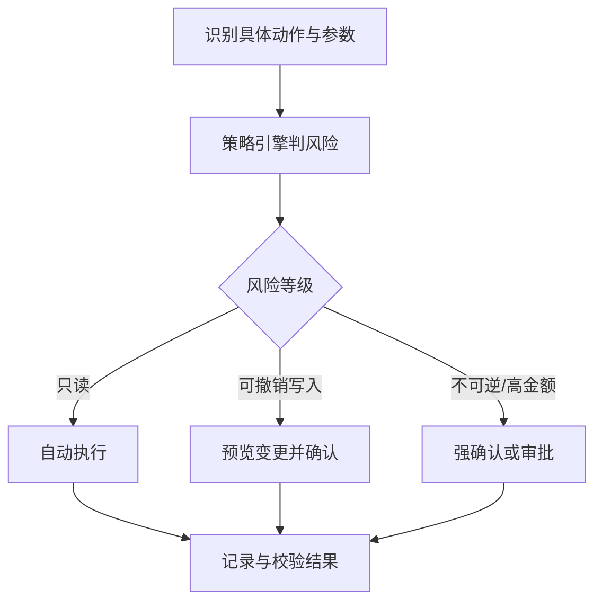

# 203｜工具调用确认，如何避免“弹窗疲劳”

> **场景引入**：每次查制度都弹窗，用户逐渐机械点击；修改银行卡却需要更强确认。确认策略应围绕实际风险。

> 对应[原始材料](../origanl/203-Agent工具调用确认机制设计.md)。

---

## 🎯 一句话定位

按副作用、可逆性、金额和隐私分级确认，并让凭证绑定具体参数。

## 💎 核心要点概览

| 动作 | 处理 |
| --- | --- |
| 只读查询 | 自动执行并记录 |
| 可撤销写入 | 预览确认 |
| 高金额或不可逆 | 强确认或审批 |

## 🚀 核心总结

> 确认是业务控制，不能仅由模型自信程度决定。

---

## 一、确认是一道业务控制

所有动作都弹窗，用户会机械点击；所有动作自动执行，又可能越权。确认门槛应按副作用、可逆性、金额、隐私和外部影响设定，而不是按模型自信程度。

报销 Agent 可自动查制度和准备草稿；提交审批需展示金额、收款对象及单据；修改银行卡应有更强校验。确认凭证应绑定这些参数、用户身份与有效期，参数变动后不能沿用旧确认。批量动作要展示影响范围，避免“确认一次”掩盖上百条写入。

系统执行层必须再次核对授权，不应只让模型在提示词中决定是否需要确认。

**面试表达：**“我用策略引擎按实际后果分级，确认内容绑定具体参数，执行层复核授权并留审计。”

---

## 二、落地 Checklist

- [ ] 策略引擎按实际对象和影响分级。
- [ ] 批量动作展示数量、范围和关键参数。
- [ ] 凭证绑定用户、参数与有效期，执行层复核。

## 三、总结（一句话带走）

> **少打扰低风险任务，严控真实副作用。**
