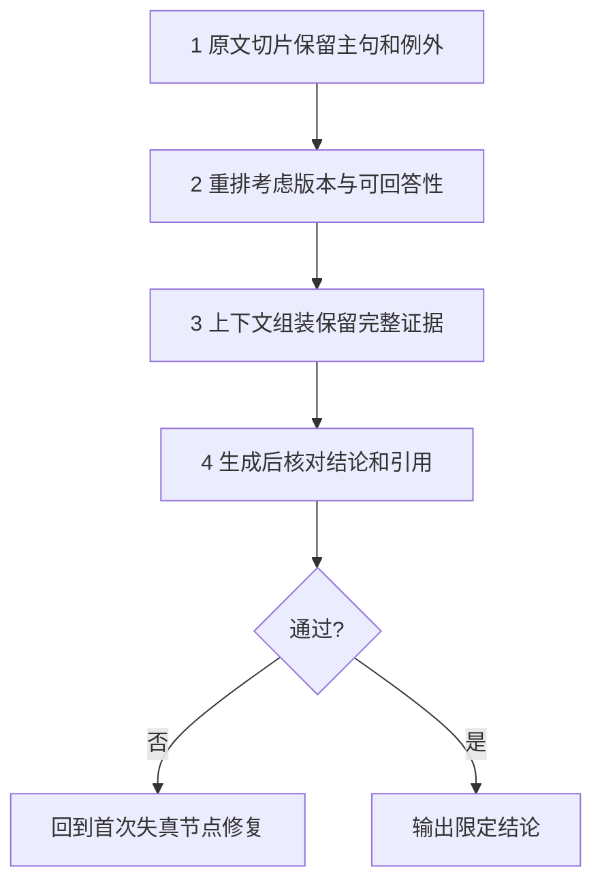

# 204｜RAG 召回对仍答错：四步看证据链

> **场景引入**：合同写“可申请退款，但企业定制版除外”，切片只保留前半句。召回看似命中，却会引导错误答案。

> 对应[原始材料](../origanl/204-RAG召回对却还答错？4步拆解真实链路.md)。

---

## 🎯 一句话定位

按切片、重排、上下文组装和生成核验四步追踪证据完整性。

## 💎 核心要点概览

| 阶段 | 查什么 |
| --- | --- |
| 切片 | 主句和例外是否同在 |
| 重排与组装 | 证据是否进入最终输入 |
| 生成核验 | 结论是否忠于引用 |

## 🚀 核心总结

> 修复证据第一次丢失或误读的位置，而非一律换模型。

---

## 一、四个检查点

合同写“可申请退款，但企业定制版除外”。若切片只留下前半句，召回命中也会导向错误答案。按“切片、重排、组装、生成核验”检查，能找出证据在哪一步失真。

每一步保存同一文档 ID、片段位置和规则版本。若原文有例外而切片没有，修分块；若切片有却没进入最终 Prompt，修预算或重排；若进入后仍漏读，做条件抽取与答案核验。不要一看到“答错”就换更大的模型。

验收要有干扰文档、旧版制度和例外条件的样本，统计每步证据保留率与最终错误结论率。

**面试表达：**“我沿四步追踪正确证据的完整性和使用情况，修复首次丢失或误读的位置。”

---

## 二、落地 Checklist

- [ ] 每阶段记录文档 ID、片段位置与规则版本。
- [ ] 区分切片丢失、重排截断和生成误读。
- [ ] 用旧版和例外干扰样例评测证据保留率。

## 三、总结（一句话带走）

> **沿四步证据链定位错答的第一处失真。**
