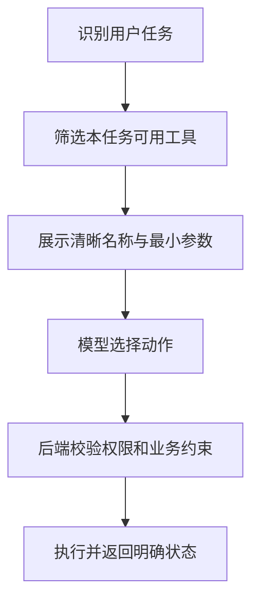

# 205｜Agent 工具为何不是越多越细越好

> **场景引入**：模型面对几十个底层订单接口，想退款却误选 `update_order`。清晰的业务动作接口更容易安全执行。

> 对应[原始材料](../origanl/205-为什么AI智能体工具不是越详细越好？.md)。

---

## 🎯 一句话定位

按任务提供少量清晰的业务工具，后端封装权限、事务和确定性规则。

## 💎 核心要点概览

| 设计 | 效果 |
| --- | --- |
| 按任务筛选 | 减少误选 |
| 业务动作命名 | 明确副作用 |
| 后端业务校验 | 限制模型越权 |

## 🚀 核心总结

> 工具描述要足够明确，但不必把全部内部 API 暴露给模型。

---

## 一、工具列表是决策界面

几十个名字相近的底层接口会增加选错工具、填错参数和越权调用的机会。给模型的是完成任务所需的清晰动作，而不是内部 API 的全量目录。

例如对模型暴露“创建退款申请”，参数是订单 ID、原因和用户确认状态；后端再处理权限、条款、审批和事务。若直接暴露 `update_order`、`insert_refund` 等底层操作，模型需自己拼接业务流程，风险更高。

工具描述仍应足够明确：适用场景、必填参数、失败语义和副作用。应按工具选择准确率、参数错误率、误调用率和延迟评估“精简”是否有效；不能为了短而删掉关键约束。

**面试表达：**“工具按业务动作设计，按任务筛选可见集合；模型选动作，后端负责权限和确定性业务规则。”

---

## 二、落地 Checklist

- [ ] 以业务动作为单位命名工具并明确副作用。
- [ ] 描述必填参数、适用场景和失败语义。
- [ ] 评测工具选择、参数错误、误调用和延迟。

## 三、总结（一句话带走）

> **让模型选择业务动作，让后端处理业务细节。**
