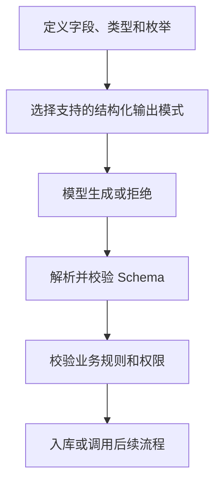

# 206｜结构化输出与 JSON mode 的区别

> **场景引入**：模型给出合法 JSON，却漏了必填字段。能解析不等于符合结构契约，更不等于金额真实。

> 对应[原始材料](../origanl/206-结构化输出与JSON模式.md)。概念以 [OpenAI Structured Outputs 文档](https://developers.openai.com/api/docs/guides/structured-outputs) 为例；其他服务商支持范围需另查。

---

## 🎯 一句话定位

JSON mode 主要保证语法可解析；结构化输出约束字段形状；业务事实仍需服务端校验。

## 💎 核心要点概览

| 层次 | 保证范围 |
| --- | --- |
| JSON mode | 可解析的 JSON |
| Schema 约束 | 字段、类型和枚举 |
| 业务校验 | 金额、权限和真实状态 |

## 🚀 核心总结

> 格式正确只是第一关，业务正确性要查权威系统。

---

## 一、JSON 合法不代表符合业务契约

JSON mode 主要保证可解析为 JSON，但可能缺字段、字段类型不对或枚举值越界。Structured Outputs 用受支持的 JSON Schema 约束结构。两者都不保证字段里的事实真实，也不代替服务端业务校验。

例如输出 `{ "amount": 100, "currency": "CNY" }`，Schema 可保证 `amount` 是数字、`currency` 属于允许枚举；但“100 元是否应退”要靠订单与政策核验。还要处理拒绝、截断、不完整输出和服务端不支持某些 Schema 特性的情况。工具调用场景应使用对应的函数/工具接口契约，而非把任意 JSON 文本当作授权动作。

**面试表达：**“JSON mode 解决语法可解析，结构化输出约束字段形状；业务正确性还需后端验证。”

---

## 二、落地 Checklist

- [ ] 定义字段、类型、枚举和拒绝处理方式。
- [ ] 解析后做 Schema 与业务权限校验。
- [ ] 处理截断、不完整输出和服务端不支持的特性。

## 三、总结（一句话带走）

> **结构约束管形状，业务系统管事实。**
