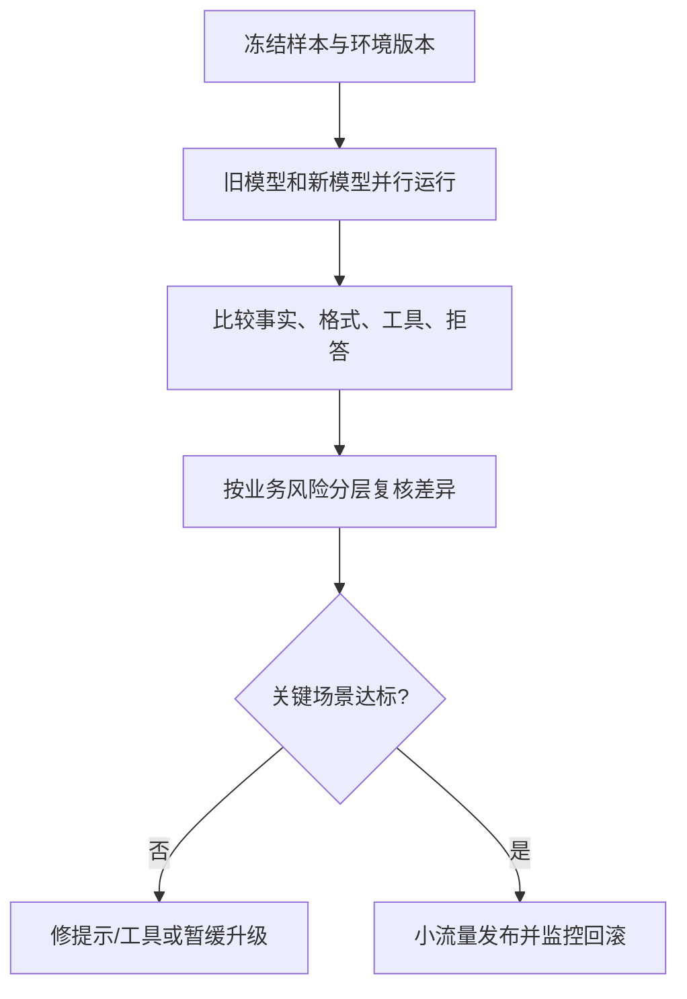

# 207｜升级模型，为什么要逐项对账

> **场景引入**：新模型总分更高，却在退款例外题上更常答错。升级评估不能只看平均分。

> 对应[原始材料](../origanl/207-大模型升级为何要做差异对账.md)。

---

## 🎯 一句话定位

固定环境双跑新旧模型，按业务风险对账事实、格式、工具行为和成本。

## 💎 核心要点概览

| 差异 | 检查 |
| --- | --- |
| 内容 | 事实、引用、拒答 |
| 执行 | 工具选择和参数 |
| 体验 | 时延、长度、成本 |

## 🚀 核心总结

> 对账要判断谁更正确及业务影响，不能只列输出不同。

---

## 一、平均分会掩盖局部退化

新模型总体分数更高，却可能在退款例外、工具参数或拒答边界上变差。模型升级还会改变回答长度、延迟与费用，影响下游解析和用户体验。应在同一输入、同一工具与知识库版本下比较新旧行为。

对账表不仅列“不同”，还列“哪一个更正确”、证据和业务影响。对确定性字段可机器比对；对事实问答需核引用；对执行流程要比较实际工具调用和副作用。高风险样本不能被整体平均分抵消。

发布时记录模型快照、Prompt、工具 Schema 与评测集版本，便于复现。上线后继续看真实用户失败率，不把离线通过当终点。

**面试表达：**“我做同场景双跑，按风险审查语义、结构和工具行为差异，再灰度验证。”

---

## 二、落地 Checklist

- [ ] 固定样本、工具、知识库和提示版本。
- [ ] 关键高风险样例单列门槛与差异复核。
- [ ] 灰度发布并监控失败率，保留回滚路径。

## 三、总结（一句话带走）

> **模型升级要逐项证明收益并看住局部退化。**
