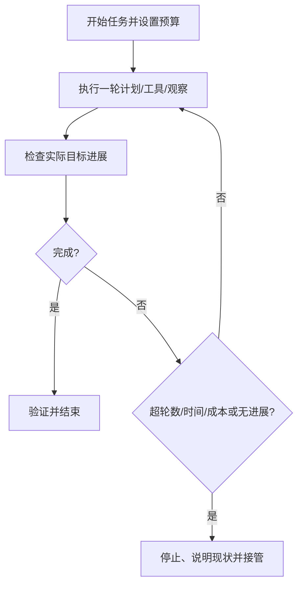

# 208｜Agent 为什么要有执行预算

> **场景引入**：Agent 每轮都换个搜索词，看起来忙碌，却始终没拿到新证据。轮数和进展都要受控。

> 对应[原始材料](../origanl/208-Agent为什么要设最大执行轮数.md)。

---

## 🎯 一句话定位

用轮数、时间、费用和可观察进展共同控制 Agent 循环。

## 💎 核心要点概览

| 边界 | 防止 |
| --- | --- |
| 轮数和时间 | 无限执行 |
| 成本和工具次数 | 资源耗尽 |
| 进展检查 | 伪进展与重复搜索 |

## 🚀 核心总结

> 达到边界要安全停止并报告已完成与未完成部分。

---

## 一、防的不是只有死循环

Agent 可能每轮都调用不同工具，看似前进，却始终没解决问题。这种“伪进展”会消耗时间、token 与外部 API 配额，还可能增加副作用。最大轮数是刹车之一，还需时间、成本、工具调用次数和状态变化检测。

“进展”应由可观察状态定义，例如已获得新的证据、订单状态改变、缺失字段减少；同义改写答案不算进展。重试要针对可恢复错误，且有退避和上限。预算耗尽时保留已有结果与未完成事项，不能继续偷偷执行。

高风险写操作还要单独设置次数和审批门槛，避免循环中重复下单。

**面试表达：**“我用轮数、时间、成本和进展检测共同控制循环；达到边界就安全停止并交代状态。”

---

## 二、落地 Checklist

- [ ] 按任务设置轮数、时间、费用和工具调用上限。
- [ ] 用新证据或业务状态变化定义实际进展。
- [ ] 高风险写工具单设次数与审批边界。

## 三、总结（一句话带走）

> **预算限制消耗，进展检查限制无效忙碌。**
