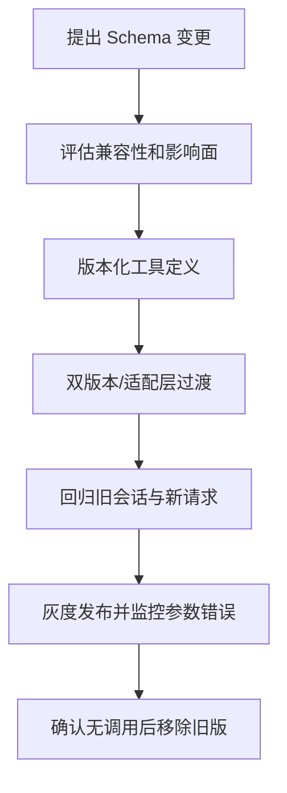

# 209｜工具参数 Schema 为何是生产契约

> **场景引入**：金额单位从“元”改成“分”，字段名没变，旧模型调用仍可能把 100 元当 100 分。语义变更尤其需要版本化。

> 对应[原始材料](../origanl/209-大模型工具参数为何不能随便改？.md)。

---

## 🎯 一句话定位

工具 Schema 是模型、服务、评测和回放共享的契约，变更需兼容迁移。

## 💎 核心要点概览

| 变更 | 风险 |
| --- | --- |
| 重命名必填字段 | 旧调用失败 |
| 枚举或默认值改变 | 旧客户端误判 |
| 单位语义改变 | 高风险业务错误 |

## 🚀 核心总结

> 字段结构和业务语义都要版本化，并按版本回归。

---

## 一、改字段会影响整条链

把 `user_id` 改名或把 `status` 从数字改成字符串，不只影响工具服务。模型可见工具定义、旧会话、评测样本、日志回放和下游解析都可能仍使用旧格式，产生间歇性失败。

新增可选字段通常比重命名必填字段容易兼容，但也需确认默认值；枚举新增值可能让旧客户端失败。工具后端应校验参数、业务权限与取值范围，不能依赖模型“自觉填对”。每条 Trace 记录调用时的 Schema 版本。

对高风险工具，参数语义变化（如金额单位从元改分）比字段名变化更危险，必须显式版本化并对账。

**面试表达：**“Schema 是模型、服务、评测和回放共享的契约；变更应版本化、兼容迁移并灰度验证。”

---

## 二、落地 Checklist

- [ ] 评估模型定义、旧会话、服务和评测的影响。
- [ ] 双版本或适配层过渡，记录调用 Schema 版本。
- [ ] 高风险单位变化显式标注并对账。

## 三、总结（一句话带走）

> **工具参数改动是生产契约变更，不是局部字段编辑。**
