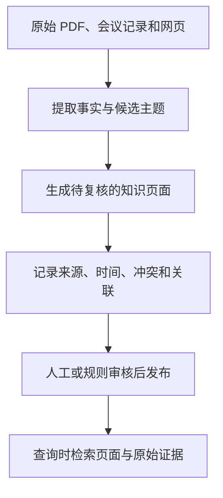

# 21. RAG 过时了吗？LLM Wiki 怎样组织和维护知识

> **场景引入**：新人想系统了解项目来龙去脉，需要主题概览；审计人员问“合同第 8 条究竟写了什么”，则需要回到原文定位证据。

> 对应原稿：[21-RAG过时了吗？LLM Wiki怎样组织和维护知识](../origanl/21-RAG过时了吗？LLM Wiki怎样组织和维护知识.md)。

---

## 🎯 一句话定位

**RAG 是“提问时找资料”，LLM Wiki 是“资料入库时先整理知识”。** 两者可以组合：Wiki 提供可阅读的主题脉络，RAG 帮用户定位原始证据。提前整理并不免除检索，也不能自动保证整理结果正确。

---

## 💎 核心要点概览

| 需求 | 合适的知识形态 |
| --- | --- |
| 按主题学习 | 有结构和关联的整理页 |
| 核对具体事实 | 原文检索与可定位引用 |
| 同时需要概览和核查 | 整理页链接原始证据 |
| 资料更新 | 处理版本、冲突、过期与重新生成 |

---

## 🚀 核心总结

> **知识可以提前整理，证据仍必须能回到原始来源。**

---

## 一、用图书馆理解两种方式

传统 RAG 像读者提问后，管理员临时从多本书中找相关段落。适合查一个具体问题，便于追溯原页。LLM Wiki 更像管理员平时就编好主题索引页，整理概念、关联和争议。读者想系统了解一个主题时更方便，但索引页需要持续修订。

| 目标 | 更直接的起点 |
| --- | --- |
| 回答“某条款写了什么”，必须引用原文 | RAG 与来源定位 |
| 新人想按主题了解项目来龙去脉 | 结构化知识页面 |
| 既要概览，又要验证每个结论 | Wiki 页面加原文检索 |

## 二、原文、整理页和检索的三层结构

原始资料层保留出处；主题页面层保存经整理的内容；维护规则层规定如何分类、更新、处理冲突。模型生成的页面是**候选整理结果**，不是天然可信的事实。页面上的关键结论应能回到具体原文。

## 三、新资料进来时怎么更新

假设旧会议纪要说“项目成本占收入 20%”，新财报写“15%”。直接用新数字覆盖旧页面，可能掩盖统计口径或时间变化。正确做法是分别记录来源、期间和计算口径，再判断这是事实更新、范围不同还是资料冲突；无法确认时保留分歧并标记待核对。

更新流程可以是：定位受影响的主题页 → 提取新事实 → 比较旧内容 → 给出变更建议 → 复核并发布 → 更新关联与索引。过时页面要能标记归档，引用不能悄悄指向不存在的旧版。

## 四、代价与边界

Wiki 需要额外的生成、复核和维护成本。知识更新频繁时，整理页可能滞后；这时应允许直接查最新原始资料。RAG 也并非只能用向量检索，还可以结合关键词、过滤与重排。两者的选择取决于用户是更常“查单个事实”，还是更常“理解一整套主题”。

## 五、面试口述版

> 我不会简单说 RAG 被 Wiki 替代。RAG 在查询时召回原始片段，适合精确问答和溯源；LLM Wiki 在入库时把资料整理成主题页面，适合长期浏览和建立关联。若两者结合，我会分开保存原文和整理页，让页面结论带来源，更新时显式处理冲突与过期内容，查询时仍能回到原始证据。

**自测：**为什么新财报的“15%”不能直接覆盖旧页面的“20%”？整理页已经存在时，为什么仍需要原文检索？

**一句话带走：知识整理可以前移，但事实验证不能省略。**

---

## 六、落地 Checklist

- [ ] 整理页的关键主张能追溯到原文与版本。
- [ ] 新资料入库时会识别同主题冲突和失效内容。
- [ ] 历史结论保留时间范围，不被新数字无条件覆盖。
- [ ] 用户能从概览跳回原始证据核查。

## 七、总结（一句话带走）

> **Wiki 帮人建立知识脉络，RAG 帮人找到可核查的证据。**
