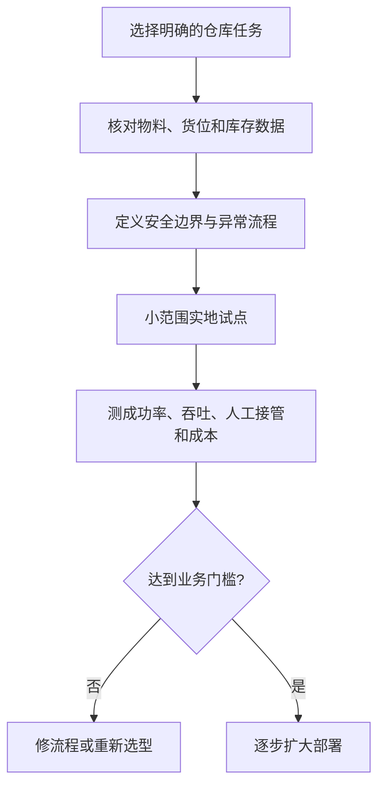

# 210｜引入机器人前，先核查业务基础

> **场景引入**：机器人能走到货架，却因库存和货位数据不准拿错货。硬件能力必须接上可信业务流程。

> 对应[原始材料](../origanl/210-别急着买人形机器人，先做好这件事.md)。原稿是观点性视频；采购时应以具体场景的试点数据判断。

---

## 🎯 一句话定位

先验证数据、流程、安全和端到端指标，再用试点结果决定机器人部署。

## 💎 核心要点概览

| 基础 | 验收问题 |
| --- | --- |
| 数据 | 货位和库存准确吗 |
| 流程 | 缺货与拿错如何处理 |
| 安全 | 人员进入作业区怎么办 |
| 经济性 | 吞吐、接管与成本是否达标 |

## 🚀 核心总结

> 演示会走路或抓取，不等于业务任务能稳定完成。

---

## 一、仓库取货不是“会走路”就够了

机器人取一箱货，需要知道订单、物料编码、货位、库存、通道状态与异常处理。若这些数据不准、流程不清，硬件演示能力无法保证业务完成率。

先定义“取对货并正确更新库存”的端到端指标，而非只测移动和抓取。缺货、拿错、通道被堵、人员进入作业区都要有停机和接管方案。是否先做软件 Agent 或先买机器人，取决于实际瓶颈和投资回报，不能一概而论。

**面试表达：**“物理执行要接上可信数据、流程和安全控制；我用小场景试点的数据决定是否扩展。”

---

## 二、落地 Checklist

- [ ] 选定明确任务并核对物料、货位和库存质量。
- [ ] 设计停机、缺货、拿错和人工接管流程。
- [ ] 试点记录端到端成功率、吞吐与总成本。

## 三、总结（一句话带走）

> **先证明业务闭环，再扩大机器人部署。**
