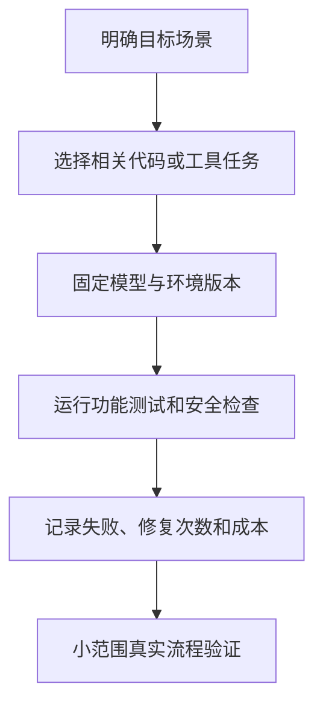

# 211｜代码榜成绩能说明 AI 会“做事”吗

> **场景引入**：模型能写库存查询函数，却未必会在下单前检查库存、处理超时与重复扣款。代码榜不能代替业务任务验收。

> 对应[原始材料](../origanl/211-大模型登顶代码榜，AI开始真正会做事.md)。原稿未给出可核查的榜单、版本和评测日期，因此不沿用“登顶”结论。

---

## 🎯 一句话定位

代码榜可作模型选型线索，真实“会做事”要用端到端任务和风险控制验证。

## 💎 核心要点概览

| 证据 | 能说明什么 |
| --- | --- |
| 榜单 | 特定测试集表现 |
| 仓库任务 | 真实代码修改与测试 |
| 业务流程 | 工具执行、安全和结果 |

## 🚀 核心总结

> 评测越接近真实任务，越能说明实际可用性。

---

## 一、代码能力为什么有参考价值

代码任务常要求理解上下文、遵守接口、运行测试并修复错误，比只评文字流畅更容易验收。但一个代码榜的成绩，不能直接推导出真实业务 Agent 会安全地操作工具或完成端到端任务。

例如模型能写出库存查询函数，不代表它会在下单前正确查库存、处理超时或避免重复扣款。企业评估应加入真实仓库、依赖、测试和权限边界，关注成功率、人工修改量、回归故障及时间成本。排行榜只能作为选型线索，不能当上线验收。

**面试表达：**“代码榜衡量一部分可验证能力；我会以真实业务任务、执行结果和风险控制评估模型是否可用。”

---

## 二、落地 Checklist

- [ ] 固定模型、环境、任务和评测日期。
- [ ] 在真实仓库与业务工具中测功能和安全边界。
- [ ] 记录人工修改量、失败次数、时间和成本。

## 三、总结（一句话带走）

> **榜单成绩是线索，真实任务完成证据才是验收。**
