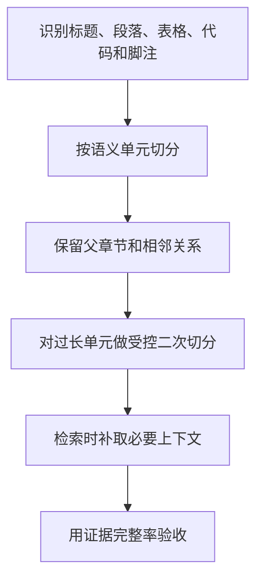

# 213｜RAG 切片为何要尊重文档结构

> **场景引入**：合同一句话前半是适用条件、后半是责任。按固定字数切断后，检索到责任却漏了前提。

> 对应[原始材料](../origanl/213-RAG文档切片为何不能只按字数.md)。

---

## 🎯 一句话定位

先识别文档结构，再按完整语义单元切片，检索后补取必要上下文。

## 💎 核心要点概览

| 内容 | 合适边界 |
| --- | --- |
| FAQ | 问答对 |
| 表格 | 表头与行列 |
| 代码 | 函数或类 |
| 合同 | 主条款、例外与脚注 |

## 🚀 核心总结

> 切片大小是参数，证据完整性是目标。

---

## 一、固定字数可能切掉前提

合同条款前半句写适用条件、后半句写责任；机械按 500 字切开后，只召回责任部分，模型就可能把有条件的责任答成无条件。切片大小是工程参数，语义边界才决定证据是否完整。

FAQ 可按问答对切；表格要保留表头与行列关系；代码块最好保留函数或类的边界；合同条款要连同例外和脚注。过大的块也会降低定位精度，因此可用“小块检索、父块补上下文”，再实测效果。

评测不只看召回率，还看必要条件是否同时进入最终上下文、引用能否定位原文。没有一种固定字数适合所有文档。

**面试表达：**“先解析结构，再按完整语义单元切片，检索后补上下文，并用条件保留率验证。”

---

## 二、落地 Checklist

- [ ] 解析标题、段落、表格、代码和脚注结构。
- [ ] 小块检索后按父块补齐必要上下文。
- [ ] 评测条件保留率、引用定位和最终答案正确率。

## 三、总结（一句话带走）

> **切片要保留完整意思，而非凑固定字数。**
