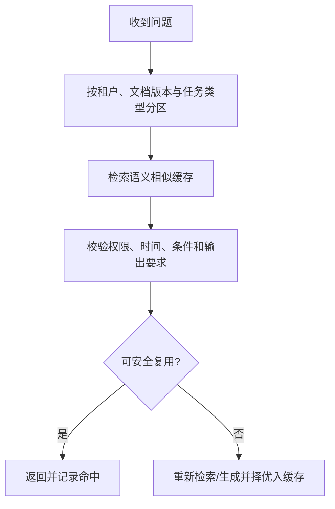

# 214｜语义缓存：何时可以复用旧回答

> **场景引入**：两个用户问法很像，但合同 ID 和权限不同。语义相似只表示候选相近，不能直接复用旧回答。

> 对应[原始材料](../origanl/214-为什么要做语义缓存？.md)。

---

## 🎯 一句话定位

语义缓存先找相似候选，再按租户、权限、文档版本、条件和时效校验可复用性。

## 💎 核心要点概览

| 检查 | 目的 |
| --- | --- |
| 租户与用户权限 | 防跨界泄露 |
| 文档与模型版本 | 防旧结果误用 |
| 任务条件与 TTL | 防相似问题不同答案 |

## 🚀 核心总结

> 命中率不能单独代表成功，错误复用率更关键。

---

## 一、相似问题不一定同答案

“这份合同有哪些风险”和“这份协议有哪些坑”可能是同一任务，但只有合同 ID、版本、用户权限、回答范围和时效都一致，才可能复用。向量相似度只能提供候选，不能单独决定缓存命中。

语义缓存可降低重复计算、延迟和高峰负载，但缓存错误会被快速放大。对法律、财务、个人数据等场景，应缩短 TTL 或禁止跨用户复用；知识库更新时按文档版本失效。缓存键可含模型/Prompt 版本，避免输出格式变更后复用旧结构。

评测要看命中率、错误复用率、时延与节省成本。错误复用率比单纯命中率更重要。

**面试表达：**“语义相似只是初筛，复用前必须校验权限、数据版本与业务条件，并具备失效机制。”

---

## 二、落地 Checklist

- [ ] 缓存按租户、文档版本和任务类型隔离。
- [ ] 命中后复核权限、条件、时间与输出要求。
- [ ] 监控错误复用率，知识更新时按版本失效。

## 三、总结（一句话带走）

> **相似可以找候选，复用必须过业务边界。**
