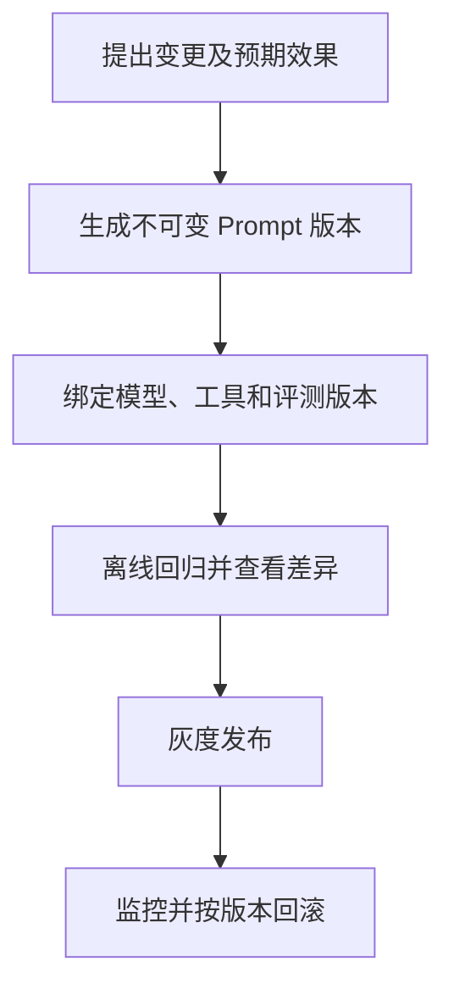

# 215｜提示词为什么要像配置一样管理

> **场景引入**：改一句“必须引用”后事实性改善，但某类问题拒答变多。没有版本记录，就无法复现和回滚。

> 对应[原始材料](../origanl/215-提示词为何要做版本管理？.md)。

---

## 🎯 一句话定位

把提示词作为影响行为的生产配置，版本化、评测、灰度和回滚。

## 💎 核心要点概览

| 阶段 | 要记录 |
| --- | --- |
| 变更 | 目的、模板和变量 |
| 评测 | 新旧差异与退化 |
| 发布 | 适用范围、版本和回滚条件 |

## 🚀 核心总结

> 小改动也可能改变工具选择与输出协议，必须可追溯。

---

## 一、小改动也会改变行为

提示词控制任务目标、证据使用、工具选择与输出格式。改一句“必须引用”可能改善事实性，也可能增加延迟或导致某类问题拒答。若只保存当前文本，线上故障无法复现。

每次请求应记录 Prompt 版本 ID，而非在日志里复制敏感完整文本。版本记录包含模板、变量定义、适用场景、变更原因、评测结果、生效范围和负责人。比较新旧版本要固定模型及数据，避免把其他变更误判为提示词效果。

回滚也需验证旧版本与当前工具 Schema 是否兼容；Prompt 不是孤立文件，而是系统契约的一部分。

**面试表达：**“版本管理让行为变化可比较、可复现、可回滚；发布前后都应按版本评测和监控。”

---

## 二、落地 Checklist

- [ ] 请求记录 Prompt 版本 ID，保留模板与变量契约。
- [ ] 固定模型和数据比较新旧版本。
- [ ] 灰度监控并核对回滚版本与工具 Schema 兼容。

## 三、总结（一句话带走）

> **提示词改动是行为变更，要像代码配置一样治理。**
