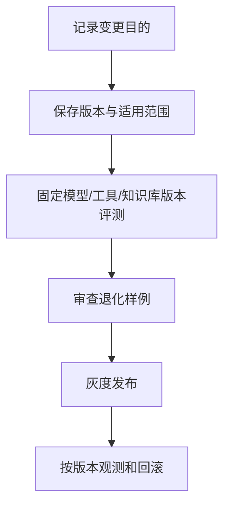

# 216｜Prompt 发布为何需要变更记录

> **场景引入**：为了减少无依据退款结论，团队增加引用要求。发布后既要看错答是否下降，也要看正常问题是否被误拒。

> 对应[原始材料](../origanl/216-大模型提示词为何要做版本管理.md)。

---

## 🎯 一句话定位

Prompt 发布记录目标、范围、版本和效果，才能区分其与模型、工具或知识库变更的影响。

## 💎 核心要点概览

| 记录 | 用途 |
| --- | --- |
| 模板哈希与变量 | 复现行为 |
| 变更原因与评测 | 判断收益和退化 |
| 上线范围与时间 | 排查与回滚 |

## 🚀 核心总结

> 版本管理的核心是对行为变化负责，而非只存一份旧文本。

---

## 一、管的是行为变更

线上 Prompt 是业务规则和输出协议的一部分。今天加一个示例、明天删一条限制，可能改变所有用户的回答。没有版本、范围和评测记录，出故障时很难分清是模型、数据还是 Prompt 导致。

至少记录版本号、文本或模板哈希、变量契约、变更原因、负责人、关联评测、上线时间与用户范围。例如“为了减少无依据退款结论，新增引用要求”；应检验错误结论率是否下降，也看是否误拒更多正常问题。

若新 Prompt 改变工具参数生成，必须同步测试工具 Schema。回滚时也要核对旧 Prompt 与当前模型、工具是否兼容，不能只替换一段文本。

**面试表达：**“Prompt 版本化是发布治理：每次变更都可追溯目标、效果、适用范围与回滚条件。”

---

## 二、落地 Checklist

- [ ] 为版本记录目的、负责人、变量契约和生效范围。
- [ ] 固定其他组件版本评测错答和误拒。
- [ ] 工具参数变化时联测 Schema，回滚前核对兼容。

## 三、总结（一句话带走）

> **Prompt 发布要能说清改了什么、产生什么效果、怎样回退。**
