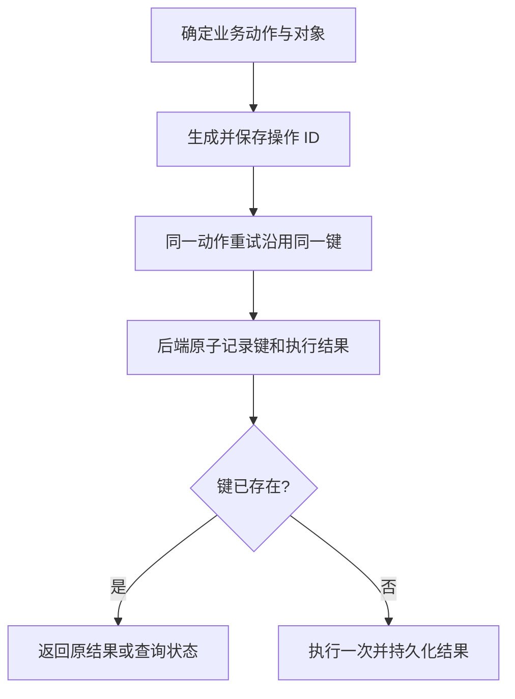

# 217｜工具调用为什么要有幂等键

> **场景引入**：创建订单请求超时，Agent 不知道订单是否已建。沿用同一业务操作 ID 重试，后端才能识别重复请求。

> 对应[原始材料](../origanl/217-工具调用为何需要幂等键？.md)。参考 [Stripe 幂等请求机制](https://docs.stripe.com/api/idempotent_requests)。

---

## 🎯 一句话定位

幂等键标识一次业务意图，由后端原子去重；超时仍需查权威状态。

## 💎 核心要点概览

| 设计 | 目的 |
| --- | --- |
| 同一操作同一键 | 防重复写入 |
| 参数绑定 | 防同键不同业务 |
| 原子记录 | 防并发双执行 |

## 🚀 核心总结

> 幂等键不能只在模型侧生成，必须由业务层持久化并执行去重。

---

## 一、标识一次业务意图

Agent 调用创建订单后超时，不知道订单是否已经创建。若重试时产生新请求，可能多建一单。幂等键使同一次业务操作的重试可被后端识别；只用用户 ID 又会把该用户不同订单混在一起。

键应与操作类型、订单、金额等参数绑定；同键不同参数须拒绝。服务端的“查键→执行→写结果”要有原子性或等效并发控制，否则两个并发请求仍可能双执行。超时后先查权威状态，不能只靠缓存键推测最终成功。

键保留期限和错误重试语义取决于具体服务，应查其文档。非幂等的外部副作用还需对账或补偿。

**面试表达：**“幂等键标识一次业务意图，后端原子去重；超时查状态，同一操作重试沿用同一键。”

---

## 二、落地 Checklist

- [ ] 键绑定操作类型、对象、金额等关键参数。
- [ ] 后端以原子机制处理查键、执行和写结果。
- [ ] 按服务文档设置保留期限和重试语义。

## 三、总结（一句话带走）

> **同一业务意图只执行一次，未知结果先查真实状态。**
