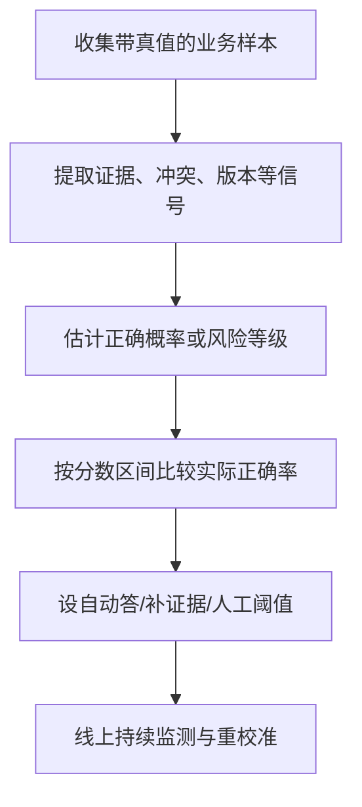

# 218｜为什么不能拿模型语气当置信度

> **场景引入**：模型笃定地说“肯定可退款”，却没有完整证据。自信语气不是正确概率，需要真实样本校准。

> 对应[原始材料](../origanl/218-为什么要做置信度校准？.md)。

---

## 🎯 一句话定位

用真实结果检验风险分数是否可信，再据业务风险设置自动回答、补证据和人工阈值。

## 💎 核心要点概览

| 信号 | 作用 |
| --- | --- |
| 证据完整性 | 判断是否可回答 |
| 版本与冲突 | 识别过期或矛盾 |
| 校准曲线 | 检查分数与真实正确率 |

## 🚀 核心总结

> 向量相似度和模型口吻都不能直接当作答案正确概率。

---

## 一、自信表达不等于正确概率

模型写“肯定可以退款”，可能只是语言风格。生产系统需要根据可观测证据判断何时自动回答、何时补检索、何时转人工。真正的校准要求：在历史样本上标为“80% 可信”的一组答案，约有 80% 确实正确；单个分数不能代替验证。

信号可包括证据是否完整、引用是否直接支持结论、文档是否过期、用户条件是否已知、工具返回是否一致。不要把向量相似度直接当答案正确概率。分数应按场景和风险分层评估；高风险业务即使平均正确率高，也可能需要人工门槛。

可画可靠性曲线并报告不同阈值下的覆盖率与错误率。知识库或模型升级后需重校准。

**面试表达：**“置信度是用真实结果校准的决策信号，不是模型自称的把握；阈值按业务风险设定。”

---

## 二、落地 Checklist

- [ ] 用带真值样本建立并检验风险分数。
- [ ] 按分数区间比较真实正确率与覆盖率。
- [ ] 模型或知识库升级后重校准，高风险另设门槛。

## 三、总结（一句话带走）

> **置信度要用事实校准，不能用语气猜。**
