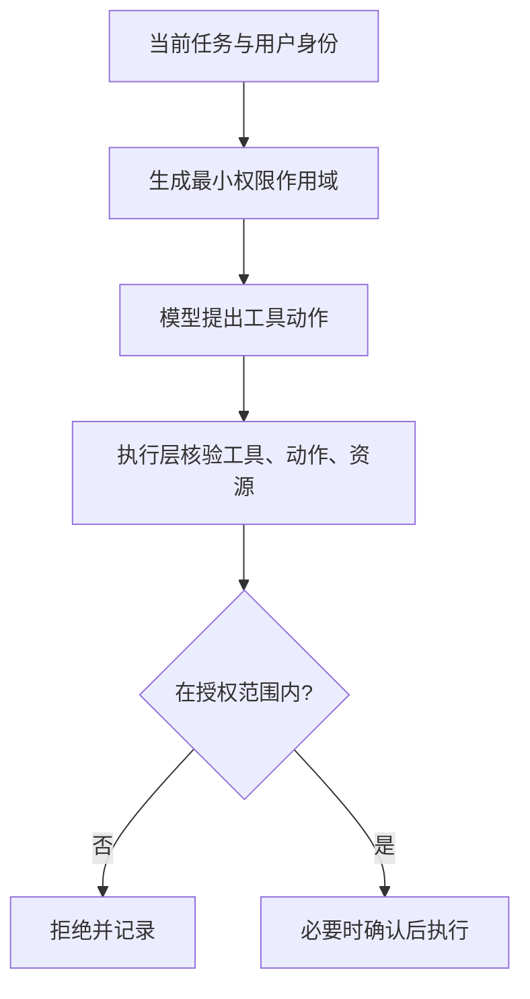

# 219｜工具权限为什么要限定作用域

> **场景引入**：用户只授权 Agent 查看本周空闲时间，却被一个“允许使用日历”总开关赋予修改他人日程的能力。授权需要更细。

> 对应[原始材料](../origanl/219-大模型调用工具为何要做权限作用域.md)。

---

## 🎯 一句话定位

工具权限按动作、资源、租户、有效期和额度限定，并在执行层强制校验。

## 💎 核心要点概览

| 作用域 | 例子 |
| --- | --- |
| 动作 | 只读、创建、删除分开 |
| 对象 | 仅本人本周日历 |
| 时间和额度 | 当前任务有效、金额上限 |

## 🚀 核心总结

> “能用工具”不等于能对所有对象执行所有动作。

---

## 一、“允许用日历”太宽泛

读取日程、创建会议、修改他人日程和发送邀请，影响完全不同。若给 Agent 一个总开关，原本只为查空闲时间授权的任务可能获得写入和外发能力。

作用域至少可按工具、动作、资源对象、租户、有效期和金额限制。例如只允许读取本人本周日历；创建会议需要用户确认；删除他人日程不授予。权限应在服务端执行层验证，不能仅靠工具描述或 Prompt 限制。

临时授权要绑定当前任务，任务结束即失效。审计记录谁授权、何时、对哪个对象执行了什么，便于追责和撤销。

**面试表达：**“我按最小权限把工具、动作和资源分开授权，并由执行层强制校验，避免模型越界。”

---

## 二、落地 Checklist

- [ ] 为任务授予最小工具、动作和资源范围。
- [ ] 执行层校验身份、租户、对象和有效期。
- [ ] 任务结束撤销临时权限并保留审计记录。

## 三、总结（一句话带走）

> **权限要精确到这次任务能对哪些对象做什么。**
