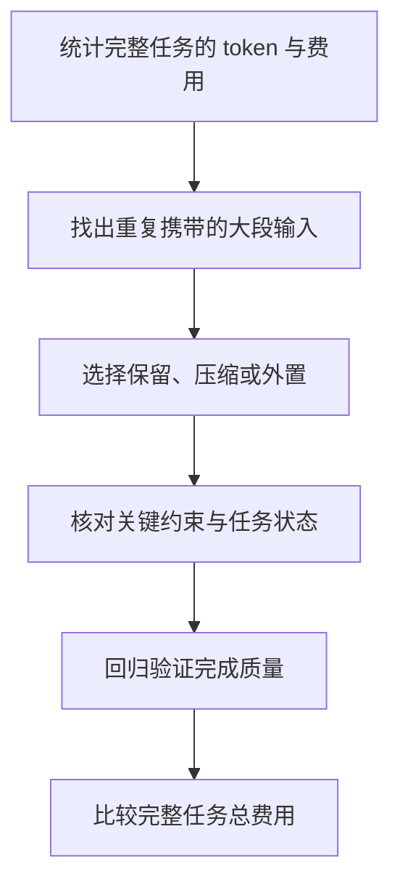

# 22. 缓存命中率高还贵？先看 Agent 重复输入总量

> **场景引入**：用户只说“继续”，系统却在每一轮都把长聊天记录和工具日志重新送给模型。账单上缓存命中率很高，总费用仍在上涨。

> 对应原稿：[22-缓存命中率高还贵？先看Agent重复输入总量](../origanl/22-缓存命中率高还贵？先看Agent重复输入总量.md)。原稿中的价格仅是示意，实际计费以所用服务的账单和规则为准。

---

## 🎯 一句话定位

**缓存命中率高，只说明较多输入按缓存规则处理；不代表输入不计费，也不代表整项任务便宜。** 要看一次任务从头到尾重复送入了多少内容、生成了多少内容，以及压缩或换会话是否带来返工。

---

## 💎 核心要点概览

| 指标 | 它能回答的问题 |
| --- | --- |
| 缓存命中率 | 有多少前缀满足缓存条件 |
| 任务输入总量 | 整个任务反复送入了多少 token |
| 输出与返工量 | 生成和失败重试花了多少 |
| 完成质量 | 压缩后是否丢失关键约束、增加错误 |

---

## 🚀 核心总结

> **降本应按完整任务核算费用与质量，不按单个缓存百分比判断。**

---

## 一、为什么只说“继续”，账单仍会增长

模型调用需要看到完成当前任务所需的上下文。用户只发两个字，系统可能仍附上长篇历史对话、工具返回和系统规则。若每一轮都携带同一段长前缀，缓存命中能降低这部分输入的单位费用，但**重复输入量 × 单位费用**仍会在多轮中累积。新增输入与输出也另算。

可以用一个简化式比较：

```text
完整任务费用 ≈ 未命中输入费用 + 命中输入费用 + 输出费用 + 摘要/交接费用 + 失败返工费用
```

各家服务对缓存的资格、有效期和价格规则不同，这个式子只帮助拆账，不代替实际账单。

## 二、两种常用优化

### 1. 压缩旧上下文

把已结束的探索过程浓缩成任务摘要，保留当前目标、用户硬性要求、已做出的重要决定、未完成事项、文件或环境的真实状态。工具的冗长原始输出可以留在外部记录中，后续需要时再取。

摘要本身有成本，也可能遗漏条件。压缩后应核对：继续执行时是否仍能正确识别目标与边界。压得过早、过频繁会花更多摘要成本；压得过狠会导致重复调查或做错事。

### 2. 新会话加状态交接

旧会话太长时，保存一份简短、可核查的交接记录，再从新会话继续。交接至少写：已完成什么、下一步是什么、哪些约束不能变、哪些结果尚未验证。新会话应读取权威任务状态，而不是只相信一段模糊的“进度不错”。



## 三、怎样判断优化有没有成功

同时看缓存命中输入、未命中输入、输出、摘要调用次数、重试次数、任务完成率和总费用。优化后命中率可能下降，但如果重复输入总量大幅减少，完整任务仍可能更便宜。反过来，单轮省钱却导致返工，整体可能更贵。

## 四、常见误区

- **“命中缓存就是免费。”** 是否收费以及收费多少要看服务规则。
- **“窗口够大就把全部历史塞进去。”** 可放入不等于值得每轮重复发送。
- **“摘要越短越好。”** 丢掉约束和未完成状态会造成错误与返工。
- **“只看单次调用。”** Agent 是多轮任务，要比较任务整体。

## 五、面试口述版

> 我会按完整任务统计命中与未命中的输入 token、输出 token、摘要开销和返工次数。缓存命中率高不代表总费用低，因为长上下文可能每轮重复发送。我会针对旧工具日志和过期对话做受控压缩，保留目标、用户约束、关键决策与当前状态；必要时做新会话交接。优化后不仅比较费用，也回归任务成功率和错误率。

**自测：**为什么压缩后命中率下降，总费用仍可能下降？哪些内容绝不能只用“越短越好”的原则处理？

**一句话带走：降本看整项任务的重复输入和完成质量，而不是一个缓存百分比。**

---

## 六、落地 Checklist

- [ ] 以任务 ID 汇总缓存输入、未命中输入、输出和返工费用。
- [ ] 识别重复携带的旧工具日志和过期对话。
- [ ] 压缩时保留目标、用户约束、关键决策及当前状态。
- [ ] 优化后比较费用、任务完成率和错误率。

## 七、总结（一句话带走）

> **缓存让重复计算便宜一些，减少无用重复输入才能改变完整任务的成本曲线。**
