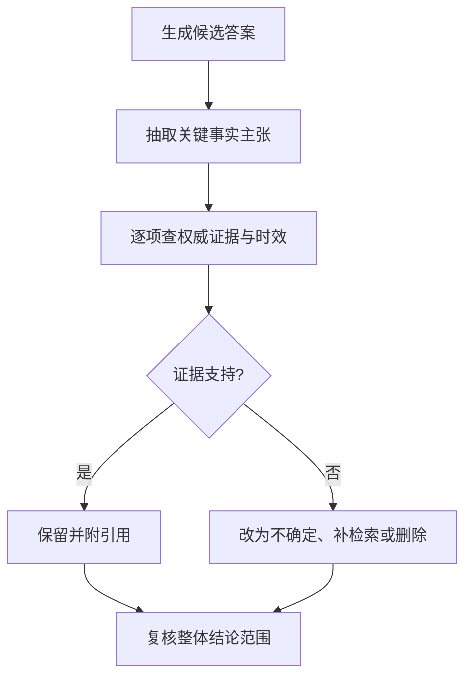

# 220｜事实问答为何必须核查主张

> **场景引入**：回答说“所有员工可报销 500 元”，引用却只适用于总部正式员工。句子很顺，主张范围却超过证据。

> 对应[原始材料](../origanl/220-事实回答为何不能只求通顺？.md)。

---

## 🎯 一句话定位

把答案拆成事实主张，逐项核对来源、时效和适用范围。

## 💎 核心要点概览

| 主张要素 | 核对 |
| --- | --- |
| 对象与地区 | 谁适用、哪里适用 |
| 时间 | 哪个版本有效 |
| 金额与例外 | 是否有直接证据 |

## 🚀 核心总结

> 引用能打开不够，引用内容还必须真正支持该主张。

---

## 一、流畅只说明表达顺

模型可以把旧版本制度和新规定拼成一段自然的话。用户最难发现的是细节丰富、语气肯定却缺证据的答案。事实问答应让每个关键主张有可追溯来源，尤其是金额、日期、权限和例外。

例如“2026 年所有员工可报销 500 元餐费”，引用只说“总部正式员工、特定城市上限 500 元”，则“所有员工”超出证据范围。核查要比较主体、地区、时间和条件，而不是看引用是否能打开。

可按主张计算支持率、过时引用率与无依据断言率；对高风险结论设置人工复核。模型生成与事实核查最好分步，但核查器本身也要用人工样本评估。

**面试表达：**“我把答案拆成可验证主张，逐项核对来源、时间和适用范围；没有证据就不写成确定事实。”

---

## 二、落地 Checklist

- [ ] 抽取金额、日期、权限和例外等关键主张。
- [ ] 核对每项主张与证据的主体、时间和条件。
- [ ] 监控无依据断言与过时引用，高风险人工复核。

## 三、总结（一句话带走）

> **事实回答要证据支撑，不能只求说得通顺。**
