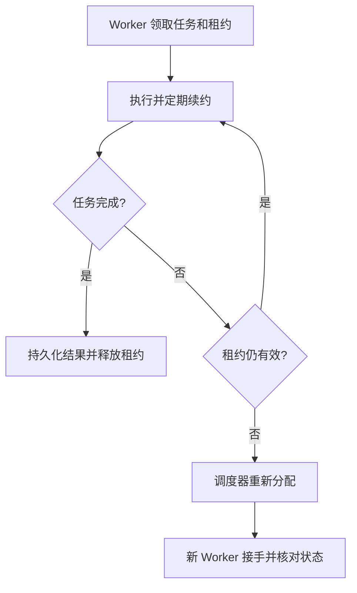

# 221｜长任务为什么需要租约机制

> **场景引入**：Worker 卡住后租约过期，调度器把任务交给新 Worker；旧 Worker 又恢复写入。租约本身挡不住双写。

> 对应[原始材料](../origanl/221-为什么要设计任务租约机制？.md)。租约与过期机制可参考 [etcd 文档](https://etcd.io/docs/v3.5/learning/api_guarantees/)；过期 Worker 的写入风险可参考 [Martin Kleppmann 的 fencing token 分析](https://martin.kleppmann.com/2016/02/08/how-to-do-distributed-locking.html)。

---

## 🎯 一句话定位

租约让长任务可重派，fencing token、幂等和状态核对防过期 Worker 双执行。

## 💎 核心要点概览

| 机制 | 作用 |
| --- | --- |
| 租约续期 | 判断 Worker 是否仍持有任务 |
| fencing token | 拒绝旧持有者写入 |
| 业务幂等 | 防重复副作用 |

## 🚀 核心总结

> 租约过期不等于旧 Worker 已停止，重要写入还需下游防护。

---

## 一、“任务在跑”需要有期限的证明

Agent 长任务可能等待工具或文件数分钟。Worker 崩溃后若任务一直标为运行中，就无人接手；若太早重派，又可能两个 Worker 同时执行。租约给 Worker 一段持有期，正常工作时续约，过期后调度器才重新分配。

租约过期不保证旧 Worker 已停：它可能只是网络卡住，之后恢复继续写。因此重要写操作应带递增的 fencing token 或版本号，由下游拒绝旧持有者写入；同时使用业务幂等键防止重复副作用。续约周期与 TTL 要考虑最长停顿、时钟和网络抖动，不能只设一个固定超时就认为安全。

**面试表达：**“租约帮助检测失联并重派任务；要防双执行，还需旧 Worker 写入隔离、幂等和状态核对。”

---

## 二、落地 Checklist

- [ ] 任务领取、续约、过期和重派状态持久化。
- [ ] 下游按递增 token 或版本拒绝旧 Worker 写入。
- [ ] 写动作加幂等键，演练卡顿恢复后的并发执行。

## 三、总结（一句话带走）

> **租约解决谁接手，fencing 与幂等解决谁能写。**
