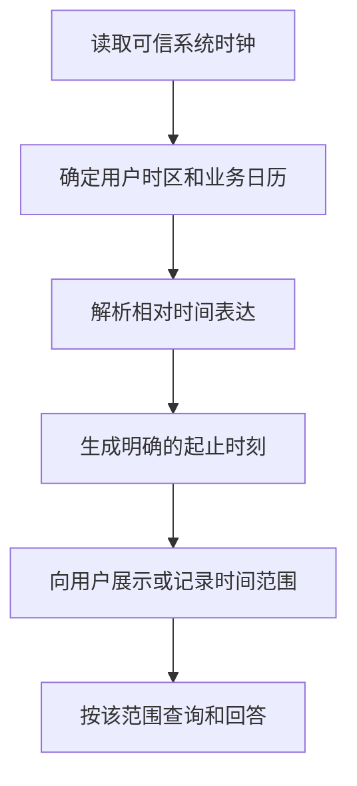

# 222｜为什么要显式提供当前时间

> **场景引入**：北京时间 11 月 4 日，用户问“昨天订单”。如果系统按 UTC 自然日查询，结果边界会错。

> 对应[原始材料](../origanl/222-大模型为何要显式传入当前时间？.md)。

---

## 🎯 一句话定位

用可信系统时钟、用户时区和业务日历把相对时间转换成明确查询区间。

## 💎 核心要点概览

| 输入 | 作用 |
| --- | --- |
| 当前时间 | 解释“昨天”“最近” |
| 时区 | 确定自然日边界 |
| 业务日历 | 处理结算日与财年 |

## 🚀 核心总结

> 时间边界由代码计算并传给工具，模型只负责理解用户表达。

---

## 一、相对时间必须落到确定边界

“昨天”“最近一周”“本季度”依赖当前时间、用户时区和业务日历。模型可能不知道运行时日期，也可能按错误时区或自然季度解释，导致查询范围错而答案看似合理。

例如用户在北京时间 2026-11-04 询问“昨天订单”，自然日范围是北京时间 11 月 3 日 00:00 至 11 月 4 日 00:00，查询数据库时可转换为 UTC 半开区间。若公司结算日从早上 6 点开始，“业务昨天”又不同；应由业务配置定义，不能让模型猜。

把 `now`、时区、周起始日、财年/结算周期作为结构化上下文输入，并在工具查询前由代码计算边界。用户指定历史时点时，以用户指定时间为准，并标明数据截至何时。

**面试表达：**“我用可信时钟和业务日历把相对时间转成明确区间，再交给工具查询，防止时区和结算口径出错。”

---

## 二、落地 Checklist

- [ ] 结构化传入 `now`、时区、周起始与结算周期。
- [ ] 查询前计算明确的半开时间区间。
- [ ] 回答标明所用时间范围和数据截止时间。

## 三、总结（一句话带走）

> **把“昨天”算成明确边界，才能查对数据。**
