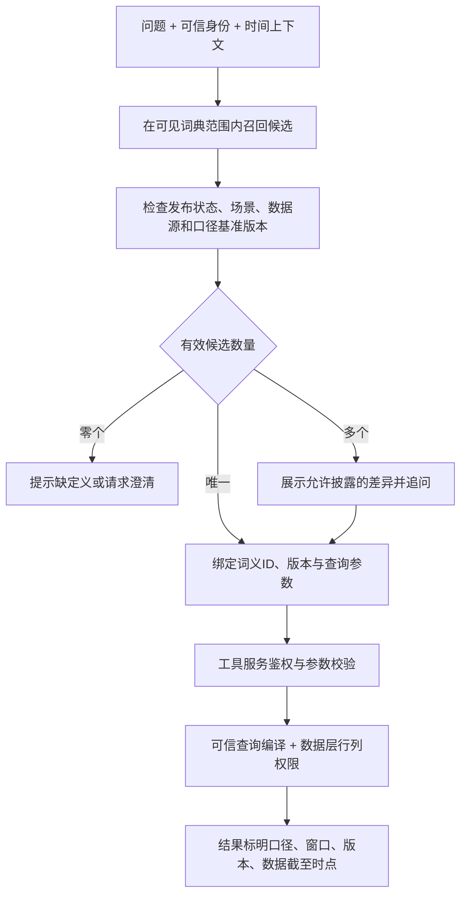

# 223｜业务词典：把自然语言对齐到确定业务口径

> 视频链接：https://www.douyin.com/video/7663883378069381873
> [豆包对话记录](../origanl/223-大模型为何要维护业务词典？.md) · [独立对话](https://www.doubao.com/chat/38450870853214466)
> **来源状态：未取得原视频正文或字幕。豆包已撤回“原视频可确认”的声明。本文全部为对豆包工程补充的整理与纠偏，不是视频摘要，不计为原片提取完成。**

## 一句话定位

业务词典是可治理的语义契约：让“活跃”“转化”先落到明确的业务对象、适用范围和计算规则，再执行查询，而不是让模型凭常识选口径。

## 一、为什么不只维护同义词

同义词回答“还有哪些叫法”，业务定义回答“到底指什么”。例如“活客”可以是“活跃用户”的别名，但“活跃用户”又可能是七日登录用户或三十日交易用户；两者不是随意互换的同义词。

| 方案 | 可以做什么 | 单独使用不足在哪里 |
| --- | --- | --- |
| 别名映射 | 将一个别名映射到一个或多个词义 ID | 若没有范围和裁决规则，仍无法择义；不是表结构天然只能单义 |
| Prompt | 放入定义、版本化管理、携带生效信息 | 仅靠模型阅读多套定义，不能保证每次选择一致；全量词条也占上下文 |
| 向量检索 | 相似词召回、存结构化 payload、metadata 过滤 | 相似不等于适用；还要验证权限、范围、版本并处理冲突 |
| 业务词典 + 规则/指标引擎 | 维护定义与计算契约，确定性解析和执行 | 要付出负责人审核、版本治理和数据对齐成本 |

词典不是与 Prompt/RAG 对立的替代品。它是受治理的数据源，检索负责找候选，规则层负责判定，模型负责理解表达和解释结果。

## 二、词条至少应说清什么

| 字段 | 用途 |
| --- | --- |
| 稳定的词义 ID、名称、别名数组 | 识别候选，避免同名词条混用 |
| 业务定义与适用范围 | 约束业务域、场景、数据源；团队身份只能作上下文，不能当授权 |
| 计算口径 | 固定事件、时间窗、去重粒度、过滤、归因规则 |
| 负责人 | 明确解释、审核与争议处理责任 |
| 版本、状态、生效区间 | 仅发布态可用，固定查询所依据的规则 |
| 修改时间 | 审计编辑，不代替生效时间 |

以下是工程示例，字段需由服务端白名单映射到可信查询，不把词条中的任意字符串当 SQL 执行。

```json
{
  "sense_id": "growth.active_user.login_7d",
  "name": "活跃用户",
  "aliases": ["活客", "登录活跃用户"],
  "definition": "过去七个完整自然日内至少成功登录一次的独立用户数",
  "scope": {"domain": "growth", "scene": "login_activity", "source": "analytics.login_events"},
  "calculation": {
    "event": "login_success",
    "distinct_key": "canonical_user_id",
    "window": "previous_7_complete_calendar_days",
    "timezone": "Asia/Shanghai",
    "interval": "[start,end)",
    "exclude_test_accounts": true
  },
  "owner": "growth-metrics-owner",
  "version": 3,
  "status": "published",
  "effective_from": "2026-11-01T00:00:00+08:00",
  "effective_to": null,
  "updated_at": "2026-10-30T14:00:00+08:00"
}
```

## 三、“活跃用户”怎样变成可执行口径

以下均为示例业务约定，不代表视频或所有企业的统一定义。

| 口径 | 时间与事件 | 去重与边界 |
| --- | --- | --- |
| 七日登录活跃 | 前七个完整自然日，成功登录事件 | canonical_user_id 去重，排除测试账号 |
| 三十日交易活跃 | 前三十个完整自然日，支付成功事件 | 用户去重；是否排除退款由业务确认，不能硬编码为必然排除 |
| 关键动作活跃 | 已配置窗口内，发布成功/提交成功等事件 | 先确定动作集合是 OR 还是 AND、是否限次数，再按用户去重 |

**具体时间例子：**2026-11-04 查询“前七个完整自然日”，以北京时间计为 `[2026-10-28 00:00, 2026-11-04 00:00)`。若问“截至现在滚动 168 小时”，这是另一种窗口，不能混用。相邻区间使用半开边界，避免边界事件重复计数。

还要写清：事件时间还是入库时间、迟到数据截止点、匿名到登录身份如何归并、封禁状态按当时还是当前判断。不是每个指标都要排除封禁用户；过滤也属于业务契约。

**退款反例：**支付后次月退款，“支付活跃”可能仍计入支付发生日，“净交易活跃”可能按规定重算；必须同时固定退款规则与数据截至时点。

## 四、转化率：先固定同一群体与统计粒度

### 1. 增长：访客注册转化率

- 分母集合 C：7 月 1 日访问指定落地页的去重访客主体。
- 分子：C 中在首次合格访问后 24 小时内完成注册的主体，按同一主体键去重。
- 如果 C 有 1000 个主体，其中 120 个满足归因条件，则转化率为 12%。
- 未登录访客不能简单按 user_id 计数，否则分母漏人。需要明确 cookie/设备/账号归并策略及跨设备无法识别的限制。
- 固定首次或末次触点归因，避免同一注册被多个渠道重复认领。归因窗未成熟时标注“暂估”。

### 2. 销售：线索成交转化率

- 分母集合 L：7 月创建、满足有效条件的独立 lead_id。
- 分子：L 中在创建后 90 天内按归因规则完成成交的 lead_id，仍按 lead_id 去重。
- 200 条有效线索，40 条线索在窗口内转化，则为 20%。同一线索成交多单只计一次。
- 一个客户对应多条线索时，需固定订单归因到哪条线索；不能拿 customer_id 去重的客户数直接除以 lead_id 去重的线索数，冒充上述线索转化率。
- 若产品要统计客户转化，应另建 customer_id 粒度的分母群体与分子，不能临时混算。

分母为零时返回“不适用/无分母”，而不是伪造 0%；尚未走完 90 天的 cohort 与成熟 cohort 不宜直接比较。

## 五、运行时先定口径，再查数据



选择不是“永远按用户所属团队”。用户明确请求销售指标，即使属于增长团队，也可以在有权限、场景明确时选销售口径。身份只是弱上下文；显式术语限定、数据源和已确认场景更直接。约束冲突时澄清，不悄悄降级到默认值。

**追问示例：**

用户：“看一下本月转化率。”

系统：“你要看落地页访问后注册的转化率，还是有效线索后成交的转化率？两者分母、归因窗和数据源不同。”

用户：“销售线索，沿用上个月口径。”

系统：固定对应词义与版本；若“上个月口径”仍有歧义，确认是当时发布版本还是现在规则重算，不能凭空推断。

### 权限不能交给提示词

1. **检索层：**限制可见词典与元数据，避免泄漏无权了解的指标定义、表结构或数据域。
2. **工具层：**服务端以可信身份校验指标、租户、参数范围，不能相信模型自行生成的身份或 SQL 限制。
3. **数据层：**通过数据网关或数据库强制行列权限；越权明确报拒绝，不伪装成“没有数据”。

## 六、更新、历史查询与缓存

- 词条采用稳定 ID + 不可变版本，草稿→审核→发布。范围和生效时间冲突在发布时检查；生效区间用 `[from,to)`。
- `updated_at` 是编辑时间，`effective_from` 是规则生效时间；未来规则不能因修改时间较新而提前使用。
- **重现当时答案：**固定当时使用的词义版本、查询参数和数据快照/截至时点。只有版本号不足以保证数据结果完全重现。
- **当前规则重算历史：**显式选择当前版本查询历史事实，并标注“重算”，不能冒充当时报表。
- 查询结果缓存键至少涵盖租户/授权范围、词义 ID、版本、规范化查询参数、时间窗、数据快照或水位。不能只用用户问句或词条 ID。
- 发布时失效“当前生效版本解析”等可变缓存；不可变版本缓存可保留。定时生效还需到点刷新或缓存不跨生效边界，不能仅依赖发布时通知。
- 回滚通过新版本重新发布既有定义，保留旧版本审计链；记录编辑、审核、差异与原因。

## 七、面试表达

“企业业务词汇不是普通同义词，而是带团队、场景、时间和数据源边界的语义契约。同样叫活跃用户，七日登录与三十日交易会算出不同结果。我们用业务词典维护稳定词义 ID、别名、定义、范围和可执行计算口径。检索找候选，规则层结合明确场景和版本确定口径，有歧义就追问；权限由工具和数据层强制执行。结果标注口径、时间窗、版本与数据截至时间，更新通过审核发布及缓存失效，支持当时口径回放和当前口径重算。”

## 落地 Checklist

- [ ] 同名多义使用不同词义 ID，而不是覆盖同一个词条。
- [ ] 定义事件、半开时间窗、时区、去重键、过滤和归因规则。
- [ ] 分子分母来自同一 cohort，粒度一致；处理零分母与未成熟窗口。
- [ ] 零候选、多个候选和场景冲突有明确交互路径。
- [ ] 元数据、工具、数据层分别实施权限约束。
- [ ] 版本、生效时间、修改时间分离；缓存隔离授权范围。
- [ ] 查询记录足以区分当时报表回放和当前规则重算。
- [ ] 另行取得原视频字幕后，再核对内容与例子；当前不宣称原片已整理完成。
