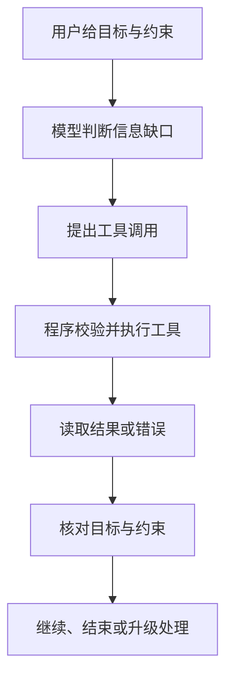

# 23. Agent 真正干活靠什么？看思考、行动与反馈闭环

> **场景引入**：用户要在 500 元预算内安排上海一日游。模型能写出漂亮行程，但票价上涨后，只有重新查询、计算并调整，任务才算真正推进。

> 对应原稿：[23-Agent真正干活靠什么？看思考、行动与反馈闭环](../origanl/23-Agent真正干活靠什么？看思考、行动与反馈闭环.md)。

---

## 🎯 一句话定位

**Agent 的关键是把“判断下一步—执行动作—读取反馈—重新判断”连成可终止的循环。** 模型提出动作，程序和工具执行动作；反馈回来后再决定继续、结束或求助。

---

## 💎 核心要点概览

| 环节 | 谁负责 | 验收依据 |
| --- | --- | --- |
| 判断信息缺口 | 模型或规则 | 知道还缺什么事实 |
| 执行动作 | 受控工具 | 有真实返回与错误状态 |
| 读取反馈 | Agent 状态层 | 知道目标是否推进 |
| 结束或接管 | 程序边界 | 满足约束或触发预算上限 |

---

## 🚀 核心总结

> **Agent 的价值在“观察后修正”，而不是只生成一份计划。**

---

## 一、上海一日游的例子

用户预算 500 元。普通对话模型可能直接给出漂亮行程，但票价或营业时间变化后，方案会失效。具备工具能力的 Agent 可以查询实时信息，算出总价，发现超预算后调整路线。

这不意味着所有事都让模型自行决定。系统仍需固定预算上限、允许的工具、最多查询次数和数据来源。否则它可能反复查价，越查越久，最后还忘了“500 元”这个约束。

图中的“继续”会回到判断环节；实际系统应限制循环轮数、时间与费用，并在无法完成时说明原因。

## 二、四类部件各司其职

| 部件 | 作用 | 一日游例子 |
| --- | --- | --- |
| 模型 | 解释目标、判断缺口、提出下一步 | 决定先查门票再查交通 |
| 工具 | 获取外部信息或执行动作 | 查询票价、路线 |
| 状态 | 保存已查价格、当前方案和失败步骤 | 避免重启后重复查全部信息 |
| 规则 | 确定目标与边界 | 总价不超过 500 元 |

“记忆”通常由应用维护，必要时放入模型上下文；模型本身不会因为上一轮说过就自动永久记住。工具返回也不能直接当真理：时间戳、来源和失败状态要检查。

## 三、一个最小练习

做一个只读的“查询天气并建议出行方式”小 Agent：目标写清楚；提供一个天气查询工具；每轮保存工具结果；模型提出建议前检查是否拿到当前城市和有效天气；天气接口失败时明确说无法核实，而不是编造。先把这条链路做稳，再加多工具和多步任务。

## 四、常见误区

- **“模型说要调用工具，就表示工具已执行。”** 动作由程序校验后才发生。
- **“有循环就有正确结果。”** 反馈也可能错误或过时，仍需验证。
- **“让模型自己决定何时停止。”** 应有最大轮数、超时和退出条件。
- **“换更强模型就能解决全部问题。”** 缺工具、缺状态或缺规则仍会失败。

## 五、面试口述版

> Agent Loop 从用户目标与约束开始。模型根据当前上下文决定是否需要工具，程序校验工具权限和参数后执行，并把结果或错误放回状态。系统再判断目标是否达成、约束是否满足；不满足则继续，但有轮数、时间和费用上限。最后输出时要核实关键事实和来源，工具失败则降级或向用户说明。

**自测：**用户预算 500 元、票价上涨 100 元时，闭环中的哪一步发现问题？模型为什么不能自己“完成”网页查询？

**一句话带走：会说计划的是模型，能根据真实反馈修正并收尾的才是执行系统。**

---

## 六、落地 Checklist

- [ ] 目标与约束有结构化记录，执行过程中不会被遗忘。
- [ ] 每次工具调用前校验权限、参数与预算。
- [ ] 工具返回后核对真实状态，而非让模型宣称完成。
- [ ] 有轮数、时间、费用和人工接管边界。

## 七、总结（一句话带走）

> **能根据真实反馈改计划，并在边界内收尾，才形成 Agent 闭环。**
