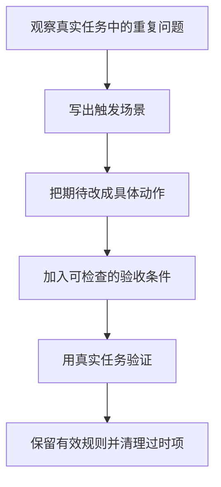

# 24. Agent 规则文档怎么写？把习惯变成可检查的动作

> **场景引入**：团队写“回答要通俗、交付前认真检查”，Agent 看似接受了要求，结果仍难判断它是否执行。问题在于规则不可操作、不可验收。

> 对应原稿：[24-Agent规则文档怎么写？把习惯变成可检查的动作](../origanl/24-Agent规则文档怎么写？把习惯变成可检查的动作.md)。

---

## 🎯 一句话定位

**一条好规则要写清“何时、对什么、做什么、怎样验收”。** “认真一点”“设计高级一点”表达了期待，却无法指导具体动作。规则文档的任务是把反复出现的工作习惯写成可执行、可检查的要求。

---

## 💎 核心要点概览

| 要素 | 写法示例 |
| --- | --- |
| 触发场景 | 首次使用英文术语时 |
| 具体动作 | 用一句中文解释，并给一个业务例子 |
| 验收方式 | 检查术语首次出现的位置是否附解释 |
| 适用范围 | 明确全局、项目或目录规则 |
| 维护 | 真实失败后修订，清理冲突和过时要求 |

---

## 🚀 核心总结

> **规则是可检查的工作动作，不是表达期待的口号。**

---

## 一、把模糊要求改成可执行规则

| 模糊要求 | 可执行规则 |
| --- | --- |
| “回答要通俗” | 首次出现英文术语时用一句中文解释，再给一个业务例子 |
| “交付前认真检查” | 交付前确认文件可打开、引用链接有效、示例命令能运行 |
| “界面要高级” | 先读取项目已有的配色和组件规范，再设计新增页面 |

这些规则能在事后检查是否执行。若检查不了，说明规则还停留在主观感受。

## 二、规则文档怎样组织

先区分通用要求与业务要求：语言、沟通方式可以放全局；代码格式、测试方法放项目；某类文件的特殊要求放对应目录。具体的加载范围和优先级要以正在使用的 Agent 工具为准，不能假设“文件放进去就一定生效”。

一份小而清晰的规则文档通常包含：适用范围、开始前的必做动作、执行中的约束、交付前的验收，以及冲突时如何处理。每条尽量只表达一个判断，避免“必须简短又必须详尽”这类互相打架的要求。

## 三、为什么规则不宜越写越多

规则占用上下文，彼此还可能冲突。先针对反复出现的真实问题写几条，验证有效后保留；习惯变化时及时删改旧规则。不要因为某次偶发错误，就把一大段特例永久加入全局规则。

规则也不是权限系统。写“绝不能删除数据库”有帮助，但危险工具仍应通过权限、确认和沙箱控制。文本约束能引导模型，程序机制才能强制边界。

## 四、动手练习

找出你最常纠正 Agent 的一个问题，例如“经常引用不存在的文件”。把它改写为：“在最终答复中提供文件链接前，先确认目标路径存在；无法确认则只描述文件名和限制。”用三个真实任务检查这条规则是否有效。

## 五、面试口述版

> 我会把反复出现的团队习惯沉淀为规则文档，但每条都要有触发条件、具体动作和验收方式。全局、项目和目录规则分开放，避免互相干扰。规则从真实失败案例中迭代，定期清理过时或冲突内容。它帮助模型保持做事方式一致，但安全权限仍要靠程序控制。

**自测：**“认真负责”为什么不是可验收的规则？什么情况下应该删除旧规则，而不是继续追加新规则？

**一句话带走：规则文档的价值不在字数，而在能指导一次真实决策并接受检查。**

---

## 六、实践 Checklist

- [ ] 每条规则写清触发条件、动作和验收方式。
- [ ] 规则放在正确作用范围，避免互相覆盖。
- [ ] 用真实失败案例验证是否有用。
- [ ] 定期删除过时、冲突或无法执行的要求。

## 七、总结（一句话带走）

> **能让另一人照着做、还能检验结果的规则，才值得写进 Agent 文档。**
