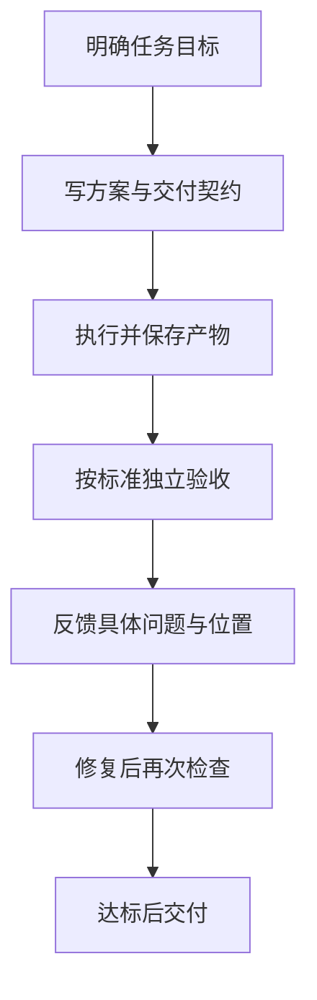

# 25. 双 Agent 闭环怎么搭？先把交接和验收写清

> **场景引入**：一个 Agent 做产品视频，另一个说“视频不够精彩”。执行者不知道改哪一秒、依据是什么，两个 Agent 只会反复空转。

> 对应原稿：[25-双Agent闭环怎么搭？先把交接和验收写清](../origanl/25-双Agent闭环怎么搭？先把交接和验收写清.md)。

---

## 🎯 一句话定位

**两个 Agent 能否协作，取决于交接物和验收标准是否明确。** “一个负责做、一个负责看”只是角色分工；只有把输入、产出、检查项、失败反馈和终止条件写清楚，才形成可运行的闭环。

---

## 💎 核心要点概览

| 角色/环节 | 必须说清什么 |
| --- | --- |
| 规划 | 目标、受众、约束、交付物格式 |
| 执行 | 产物版本、依赖素材、执行状态 |
| 验收 | 检查项、证据位置、通过条件 |
| 返工 | 具体错误、修改建议与次数上限 |

---

## 🚀 核心总结

> **交接物可复现、问题反馈可定位，双 Agent 才可能形成闭环。**

---

## 一、用短视频制作为例

规划者把“做一个产品介绍视频”转成执行方案：目标观众是谁、长度范围、必须出现的产品事实、脚本与配音文件的格式、成片如何检查。执行者按方案产出脚本、音频和成片。验收者逐项核对，指出具体问题并返回修改要求。

“视频不够精彩”无法让执行者定位问题；“第 30 秒字幕把产品名写错，原始资料第 2 页写的是 ××”就能修复并复查。

图中的复查可重复，但应设置最大轮次和人工接管条件，避免两个 Agent 无休止地互相退回。

## 二、交接协议至少包含什么

| 字段 | 要回答的问题 |
| --- | --- |
| 目标与边界 | 最终交付什么，哪些内容不能改？ |
| 输入 | 资料在哪里、哪个版本有效？ |
| 步骤与负责人 | 谁做哪一步，何时交接？ |
| 产物 | 文件路径、格式、命名和必要元数据是什么？ |
| 验收标准 | 怎样判定内容、格式、安全要求都通过？ |
| 失败反馈 | 问题位置、原因、修改建议和复查方式是什么？ |

例如执行者说“我完成了配音”，但没有留下音频文件路径、格式或版本，验收者就无法继续。**交接的是可使用的成果和状态，不是一句“完成了”。**

## 三、验收 Agent 也会出错

独立检查增加发现错误的机会，但同样可能漏看或误判。能用程序检查的项目先用确定性工具：文件是否存在、格式是否正确、字幕时间轴是否越界。内容事实与表达质量再交给人工或模型辅助检查。高风险结论不能仅凭第二个模型点头。

是否需要两个 Agent，要看独立验收能否带来足够收益。简单任务由一个 Agent 加程序校验也可能更快；复杂、多产物任务才值得分角色。

## 四、面试口述版

> 我会先定义方案、执行、验收三种职责和交接契约。每一步交付具体文件、状态和版本；验收按预先约定的检查项进行，问题反馈必须给出位置、原因和可执行修改。能程序化检查的先自动检查，内容判断再用模型辅助；循环有次数和人工接管边界。双 Agent 的价值来自独立检查与明确交接，不是多开一个模型实例。

**自测：**为什么只写“脚本完成”不能算交接？验收者说“不够高级”，执行者接下来会遇到什么困难？

**一句话带走：协作闭环的基础，是可交接的产物与可复查的标准。**

---

## 五、落地 Checklist

- [ ] 任务输入、输出格式和完成条件可检查。
- [ ] 每次交接保留产物版本与来源资料。
- [ ] 返工意见指出位置、原因和验收方法。
- [ ] 自动检查与内容判断分工清楚，循环有上限。

## 六、总结（一句话带走）

> **增加一个 Agent 不会自动提升质量；明确的交接与验收才会。**
