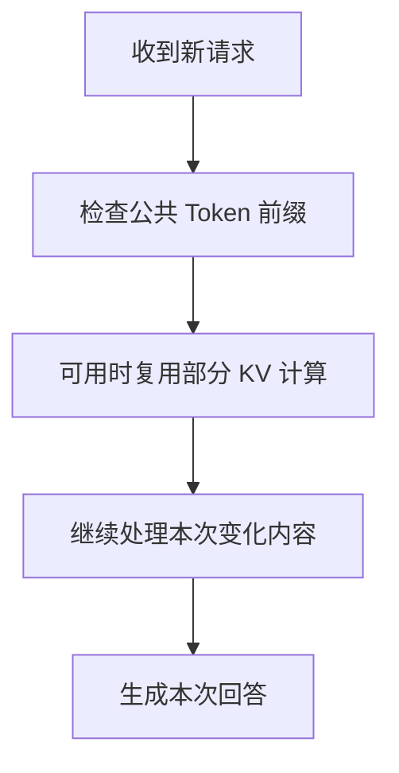

# 26. 多 Agent 缓存复用：KV 前缀与结果缓存要分清

> **场景引入**：两位客服读同一份公司规则，却分别处理不同用户的订单。共同说明可以复用计算，但第一位客服的订单答复不能直接给第二位。

> 对应原稿：[26-多Agent缓存复用：KV前缀与结果缓存要分清](../origanl/26-多Agent缓存复用：KV前缀与结果缓存要分清.md)。

---

## 🎯 一句话定位

**KV 前缀缓存复用的是模型计算过的公共前缀；结果缓存复用的是过去的答案。** 前者通常仍要继续模型推理，后者可能直接跳过推理。匹配条件、收益和风险都不同，不能只说“两个 Agent 共享缓存”。

---

## 💎 核心要点概览

| 缓存类型 | 复用对象 | 主要检查 |
| --- | --- | --- |
| KV 前缀缓存 | 相同 token 前缀的计算状态 | 模型、前缀、服务支持情况 |
| 结果缓存 | 曾生成的答案 | 用户权限、业务对象、版本、时效 |
| 两者共同点 | 都可减少重复工作 | 收益须按完整任务评测 |

---

## 🚀 核心总结

> **复用计算不等于复用结论；后者必须承担事实与权限正确性的责任。**

---

## 一、用两位客服理解

两位客服先读同一份公司说明，再分别处理不同用户问题。KV 前缀缓存像把共同说明的阅读准备工作省掉，后面各自的问题仍要单独处理；结果缓存像直接拿上一位客服的答复给下一位。第二种如果涉及不同订单或权限，可能答错甚至泄漏信息。

| 对比 | KV 前缀缓存 | 结果缓存 |
| --- | --- | --- |
| 保存内容 | 推理中的 Key/Value 中间状态 | 请求与对应答案 |
| 典型命中条件 | 同一模型、相同 Token 前缀、推理服务支持 | 缓存键或语义匹配，并通过业务校验 |
| 命中后 | 省去部分前缀计算，后续仍推理 | 可直接返回历史结果 |
| 最大风险 | 前缀变化或缓存被淘汰，收益消失 | 用户、时间、权限或业务状态不一致 |

若前缀缓存不可用，系统正常重算；若结果缓存存在，也必须经过独立的业务有效性判断。两类缓存是不同层面的优化。

## 二、工程上怎么做

把所有任务都需要、且确实相同的说明放在输入前部；用户 ID、当前任务、动态工具结果放后面。是否真能复用，要看推理服务的实现、模型版本、Token 序列和缓存淘汰策略。Agent 名称相同并不是命中依据。

结果缓存只适合可复用的内容，例如某个稳定的公开说明。涉及个人订单、权限、实时价格、资金操作时，要把租户、用户、版本和有效期纳入键或直接不缓存。**相似问法不等于相同业务上下文。**

评估时分别看前缀命中、首次输出延迟、显存或算力开销，以及结果缓存的错误复用率。不要为了做长公共前缀，把不必要的工具权限塞给所有 Agent。

## 三、面试口述版

> KV 前缀缓存属于推理层，复用同模型下完全一致的 Token 前缀对应的计算状态，后面的输入和输出仍需计算；结果缓存属于应用层，命中后可能直接返回旧答案。前者看推理引擎与前缀一致性，后者看业务上下文、权限和时效。多 Agent 优化可以把稳定的公共说明前置，但不能为了命中率牺牲工具边界，更不能把 A 用户的结果直接复用给 B 用户。

**自测：**公共提示词开头多了 `user_id`，前缀复用会怎样？“查询我的订单”两次问法完全相同，为什么不能直接复用答案？

**一句话带走：复用计算与复用结论，是两种完全不同的承诺。**

---

## 四、落地 Checklist

- [ ] 稳定公共前缀在前，用户私有信息不会混入共享部分。
- [ ] 结果缓存命中前核对租户、对象、权限、版本和时间。
- [ ] 统计缓存收益时同时观察错误复用率。
- [ ] 不为了命中率扩大 Agent 的数据访问范围。

## 五、总结（一句话带走）

> **KV 前缀缓存省计算，结果缓存省回答；安全条件不能混用。**
