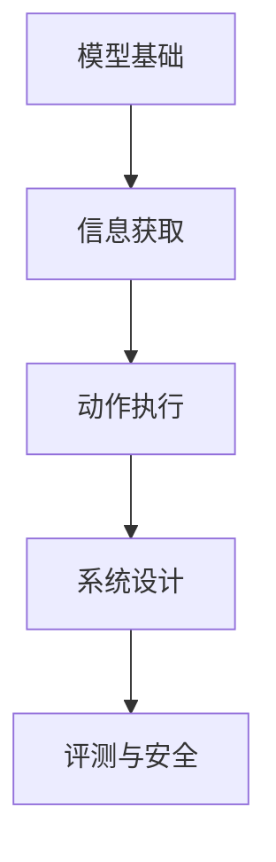

# 27. 《小哲大模型知识点体系课》17 大模块、280+ 知识点：怎样看课程清单

> **场景引入**：课程目录列出许多知识点，学完却仍说不清“用户退款请求如何从资料检索走到安全执行”。问题是知识点没有连成任务链。

> 对应原稿：[27-《小哲大模型知识点体系课》17大模块 280+知识点](../origanl/27-《小哲大模型知识点体系课》17大模块 280+知识点.md)。原稿是课程介绍，所列数量与服务为原稿陈述；本文将其转换为可独立使用的学习检查表。

---

## 🎯 一句话定位

**课程目录的价值在于知识之间能否连成可实践的链路，不在于模块或知识点数量。** 了解 Token、RAG、工具调用和框架各是什么只是第一步，还要能说明它们怎样共同完成一个任务。

---

## 💎 核心要点概览

| 学习层次 | 最低验收 |
| --- | --- |
| 模型基础 | 解释上下文、输出约束与失败处理 |
| 信息获取 | 找到证据并回到原文 |
| 动作执行 | 安全调用工具并核对结果 |
| 系统设计 | 处理状态、取消、协作与成本 |
| 评测安全 | 发现错误并阻断越权动作 |

---

## 🚀 核心总结

> **学习目录是地图，能完成并验证任务才是到达目的地。**

---

## 一、把清单整理成五层

| 层次 | 学习重点 | 能力检验 |
| --- | --- | --- |
| 模型基础 | Token、上下文、幻觉、输出约束 | 能解释模型为何会编造或漏掉信息 |
| 信息获取 | 文档解析、切片、Embedding、检索 | 能定位回答所依据的原文 |
| 动作执行 | 工具调用、参数、权限、状态 | 能安全查询与处理一次业务请求 |
| 系统设计 | 多步流程、记忆、协作、成本 | 能解释失败后怎样恢复 |
| 评测与安全 | 测试集、观测、注入防护 | 能发现和修复错误案例 |

框架与协议应放进具体能力里学。例如 LangGraph 帮你组织有状态流程，MCP 是一种工具接入协议；它们不能替代业务权限和质量验证。

## 二、一个实用的学习顺序

先做单轮问答与结构化输出，再用文档构建可引用的问答；随后接只读工具；再实现需要确认的写操作；最后补状态、取消、观测和评测。每个阶段都让同一个小项目多一项能力，避免“十个 Demo 都能运行，却没有一个能完整处理失败”。

原稿还提到动画、图解资料、答疑和退款。选择课程前，应看真实目录、试学内容、示例代码能否运行、是否解释设计取舍，以及最新服务条款。不能只根据宣传中的总时长或字数判断学习效果。

## 三、深度追问与自测

1. 知道 RAG 的全称，是否就能解释扫描 PDF 为什么可能召回错误？
2. 会调用退款工具，是否就能安全完成退款？还缺什么？
3. 学一个新框架时，你会先问它解决了哪类已存在的问题吗？

**一句话带走：把知识点变成可验证的任务能力，目录才真正有用。**

---

## 四、实践 Checklist

- [ ] 每个知识点都能对应一个具体问题或失败场景。
- [ ] 同一个小项目逐步加入检索、工具、状态和评测。
- [ ] 框架选型能说出代价与替代方案。
- [ ] 课程宣传数字与实际技能验证分开看。

## 五、总结（一句话带走）

> **会说名词不等于会做项目；能力要落在可复现的任务结果上。**
